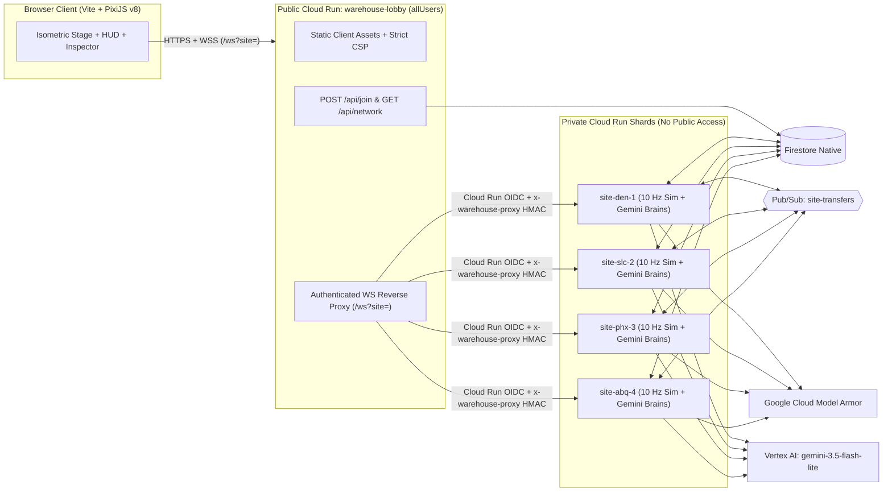

# Warehouse Distribution Network

An always-running, multiplayer isometric forklift logistics game and production AI engineering sandbox built on **Google Cloud Run**, **Vertex AI (`gemini-3.5-flash-lite`)**, **Google Cloud Model Armor**, **Firestore**, and **Pub/Sub**.

---

## What It Is

**Warehouse Distribution Network** drops human players and autonomous AI forklift fleets onto shared, authoritative **10 Hz** warehouse floors across four regional distribution hubs:

| Site ID | Regional Facility | Theme & Cargo | Default Fleet & Scaling |
|---|---|---|---|
| **`den-1`** | **Rocky Mountain Freight Hub** (Denver, CO) | Classic 3×2 freight racks, banded shipping cartons (`DEN-*`) | **24/7 Home Shard** (`min=1`, `IDLE_POLICY=run`, 20 AI agents) |
| **`slc-2`** | **Bonneville Hydroponics & Nursery** (Salt Lake City, UT) | 4×2 botanical conservatory, terracotta planters & living foliage (`BOT-*`) | **Overflow Shard** (`min=0`, `IDLE_POLICY=break`, 12 AI agents) |
| **`phx-3`** | **Sonoran Silicon & Solar Fab** (Phoenix, AZ) | 2×3 cleanroom wafer fab, FOUP wafer pods & cryo Dewars (`FAB-*`) | **Overflow Shard** (`min=0`, `IDLE_POLICY=break`, 12 AI agents) |
| **`abq-4`** | **Mesa Verde Kiln & Artisan Works** (Albuquerque, NM) | Asymmetric 3×3 artisan kiln floor, turquoise-glazed ceramics (`KLN-*`) | **Overflow Shard** (`min=0`, `IDLE_POLICY=break`, 12 AI agents) |

Players steer forklifts in real time (`WASD` / arrow keys or click-to-drive autopilot), pick up inbound pallets from west receiving docks or storage racks, weave through traffic, charge batteries before running dry, clear damaged **Returns & QA (`RET`)** spills, and deliver freight to colour-matched east shipping bays—or ship cross-site pallets (`→ network`) over Google Cloud Pub/Sub to sibling warehouses for a **+5 pt** stowage bonus.

At the same time, players act as **Shift Managers**: dealing shift policy cards, triggering rush waves, placing traffic cones, and issuing natural-language manager commands (`nlCommand`) that are screened by **Google Cloud Model Armor** and translated into structured actions by **Vertex AI Gemini 3.5 Flash-Lite**.

---

## Why We Made It

1. **Because driving a forklift is fun.** Snatching a high-priority `P0` pallet off a busy dock, threading a narrow aisle past twenty autonomous forklifts, and sliding onto a charger pad at `8%` battery with a 3D isometric PixiJS v8 renderer is immediately tactile and rewarding.
2. **To have a real, high-frequency sandbox for building and testing AI features.** Most AI demos are turn-based chat boxes. We wanted an always-on, multiplayer environment with real physics, contention, latency budgets, and untrusted public users where we can design and benchmark production AI patterns end-to-end:
   - **Hybrid Neuro-Symbolic Agent Control**: High-level tactical reasoning (`gemini-3.5-flash-lite` choosing strategy weights, shift cards, and natural-language command routing with strict JSON schemas) paired with deterministic 10 Hz physics, occupancy reservations, and A\* pathfinding (`packages/sim`).
   - **Live Multi-Agent Strategy Evaluation**: Every AI forklift is assigned to one of four strategy cohorts (**Balanced**, **Speed First**, **Safety First**, **Zone Specialist**) and benchmarked live alongside **Human Drivers** on the Strategy Board (`Orders/hr`, `On-time %`, `Incidents`, `kWh/order`, and `Value Created`).
   - **Adversarial Prompt Defense in Public Multiplayer**: Untrusted natural-language manager orders pass through a **7-layer Prompt Armor pipeline** (`packages/armor`) combining Unicode hygiene, **Google Cloud Model Armor** (`sanitizeUserPrompt` + `sanitizeModelResponse`), cryptographic nonce-fenced least-privilege parsing, Zod command validation, and per-player governance clamps.
   - **Real-Time AI Observability & Hard Cost Guardrails**: Every Gemini decision, token count, latency measurement, and prompt-armor verdict is streamed to the in-game **Brain Log** inspector and persisted to a TTL-indexed Firestore journal, governed by a transactional daily spend ledger (`$12.50/day` global AI brain cap + `$1.50/day` isolated `nlCommand` slice) and an automatic **Factory Break** state machine that scales idle overflow shards to zero.

---

## Architecture & Security Model (Frontend-Only Public Exposure)

Only the **frontend gateway (`warehouse-lobby`)** is publicly accessible on the internet. All backend **game engine shards (`site-den-1`, `site-slc-2`, `site-phx-3`, `site-abq-4`)** are private services isolated behind Cloud Run IAM and service-to-service cryptographic authentication:



### Defense-in-Depth Highlights
- **Private Backend Game Engines**: `site-*` Cloud Run services do **not** grant `roles/run.invoker` to `allUsers`. Only the `warehouse-lobby` service account (for WebSocket proxying) and the `warehouse-pubsub-push` service account (for cross-site pallet transfers on `/internal/transfer`) can invoke backend shards.
- **Dual-Layer Gateway Authentication (`OIDC` + `x-warehouse-proxy`)**: When `warehouse-lobby` proxies a client WebSocket connection (`/ws?site=<siteId>`) to a backend shard, it attaches both a Google-signed OIDC ID token (`Authorization: Bearer <idToken>`) and a short-lived, domain-separated HMAC proxy header (`x-warehouse-proxy` signed with `warehouse-proxy-header-v1:`). Direct external requests to backend shards or internal diagnostic routes (`/api/state`, `/api/status`, `/api/ticket`, `/api/journal`, `/internal/wake`) are rejected with `403 Forbidden`.
- **60-Second HMAC Join Tickets**: `POST /api/join` issues a single-use, 60-second HMAC ticket (`warehouse-join-ticket-v1:`) binding `{ clientId, name, siteId, exp }` using a key stored in **Google Cloud Secret Manager (`ticket-hmac-key`)**.
- **7-Layer Prompt Armor (`@warehouse/armor`)**: Protects `nlCommand` and player callsigns against prompt injection, jailbreaks, malicious URIs, XSS, and budget exhaustion. Validated against a 60-case adversarial red-team corpus (`packages/armor/redteam/corpus.jsonl`).
- **Zero Hardcoded Secrets**: All authentication uses **Google Cloud Application Default Credentials (ADC)**, Least-Privilege Service Accounts, and Secret Manager. `.dockerignore` and `.gcloudignore` prevent local `.env` files or Terraform state files from ever entering build contexts or container images.

---

## Repository Layout

```text
warehouse/
├── packages/
│   ├── protocol/       # Shared Zod wire schemas, quantized delta codecs, HMAC ticket & proxy header signing
│   ├── sim/            # Deterministic 10 Hz warehouse physics, A* pathfinding, orders, factory break state machine
│   └── armor/          # 7-layer Prompt Armor hygiene, nonce fencing, governance clamp & red-team corpus
├── apps/
│   ├── client/         # PixiJS v8 isometric frontend, HUD, Strategy Board, Brain Log & History drawer
│   ├── lobby/          # Public HTTP/WebSocket gateway, shard placement directory & static asset server
│   └── site/           # Private authoritative regional game engine shard, Vertex AI brains & Firestore store
├── tools/
│   ├── sprites/        # Deterministic procedural sprite & audio asset generator
│   ├── smoke/          # Live HTTP/WS, Prompt Armor, and headless Chrome UI verification probes
│   └── loadtest/       # 128-client load test harness (112 protocol bots + 16 Gemini 3.5 Flash-Lite pilots)
├── infra/              # Terraform IaC for Cloud Run, IAM, Secret Manager, Pub/Sub & Firestore TTL
└── docs/               # Detailed architecture, protocol, simulation, security & operations reference docs
```

---

## Running Locally

### Prerequisites
- **Node.js 22+** and **npm**
- *(Optional for live Gemini / Model Armor / Firestore integration)*: `gcloud` CLI authenticated via Application Default Credentials:
  ```bash
  gcloud auth application-default login
  ```

### 1. Install & Build
```bash
npm install
npm run build
```
*(Builds are orchestrated and cached via [Wireit](https://github.com/google/wireit), including procedural sprite generation in `tools/sprites`.)*

### 2. Run the Fast Offline Test Suite
All unit and integration tests run completely offline in a few seconds without requiring cloud credentials:
```bash
npm test
```

### 3. Start a Local Site Engine & Lobby Gateway
Copy `.env.example` to `.env` (or export environment variables directly) and run a local backend shard (bound to `127.0.0.1:8081`) plus the public lobby gateway (`http://127.0.0.1:8080`):

```bash
# Terminal 1: Start local DEN-1 game engine shard on 127.0.0.1:8081
SITE_ID=den-1 PORT=8081 HOST=127.0.0.1 TICKET_SECRET=local-dev-secret-change-me \
  node apps/site/dist/index.js

# Terminal 2: Start local lobby gateway on http://127.0.0.1:8080 (proxies /ws?site=den-1 -> 127.0.0.1:8081)
PORT=8080 HOST=127.0.0.1 TICKET_SECRET=local-dev-secret-change-me \
  SITE_WS_URLS='{"den-1":"ws://127.0.0.1:8081/ws"}' \
  node apps/lobby/dist/index.js
```

Open **`http://127.0.0.1:8080`** in your browser to jump onto the warehouse floor.

---

## Deploying on Your Own Google Cloud Project

You can deploy the entire 4-shard distribution network and public lobby gateway to your own GCP project using **Cloud Build** and **Terraform** (`infra/`).

### Prerequisites
1. A Google Cloud project with billing enabled.
2. **Firestore Native** database (`(default)`) created in your target region (default `us-central1`).
3. Authenticate your local CLI:
   ```bash
   export PROJECT_ID="your-gcp-project-id"
   export REGION="us-central1"
   gcloud config set project "${PROJECT_ID}"
   gcloud auth login
   gcloud auth application-default login
   ```
4. Enable the base bootstrap APIs (Terraform will enable the rest automatically):
   ```bash
   gcloud services enable \
     cloudbuild.googleapis.com \
     artifactregistry.googleapis.com \
     run.googleapis.com \
     secretmanager.googleapis.com \
     firestore.googleapis.com \
     pubsub.googleapis.com \
     aiplatform.googleapis.com \
     modelarmor.googleapis.com
   ```

### Step 1: Create the Artifact Registry Repository & Build Container Images
Create the Docker repository (or let `terraform apply -target=google_artifact_registry_repository.warehouse` create it first) and submit the multi-stage build to Google Cloud Build:

```bash
terraform -chdir=infra init
terraform -chdir=infra apply \
  -target=google_artifact_registry_repository.warehouse \
  -var="project_id=${PROJECT_ID}" \
  -var="region=${REGION}"

gcloud builds submit --config=cloudbuild.yaml --project="${PROJECT_ID}" .
```

### Step 2: Provision Cloud Run Shards, IAM, Pub/Sub & Secret Manager
Validate and apply the full Terraform configuration:

```bash
terraform -chdir=infra fmt
terraform -chdir=infra validate
terraform -chdir=infra apply \
  -var="project_id=${PROJECT_ID}" \
  -var="region=${REGION}" \
  -var="suffix="
```

Terraform will provision:
- **Secret Manager**: `ticket-hmac-key` with a cryptographically generated 64-character secret.
- **Least-Privilege Service Accounts**:
  - `warehouse-site`: Runs the 4 regional shards (`roles/datastore.user`, `roles/pubsub.publisher`, `roles/aiplatform.user`, `roles/modelarmor.user`, plus read access to `ticket-hmac-key`).
  - `warehouse-lobby`: Runs the public gateway (`roles/datastore.user`, `roles/run.invoker` on all 4 `site-*` services, plus read access to `ticket-hmac-key`).
  - `warehouse-pubsub-push`: Delivers cross-site pallet transfers (`roles/run.invoker` on `site-*`).
- **4 Private Cloud Run Site Services** (`site-den-1`, `site-slc-2`, `site-phx-3`, `site-abq-4`) with `REQUIRE_PROXY_AUTH=1` and zero public `allUsers` access.
- **1 Public Cloud Run Lobby Gateway** (`warehouse-lobby`) with `allUsers` invoker access and 3600s WebSocket proxy timeout.

### Step 3: Verify Your Live Deployment
```bash
LOBBY_URL=$(terraform -chdir=infra output -raw lobby_url)

# 1. Probe public gateway health
curl -fsS "${LOBBY_URL}/healthz"

# 2. Run end-to-end gameplay + cross-site transfer smoke test
node tools/smoke/live.mjs "${LOBBY_URL}"

# 3. Run live Prompt Armor injection verification
node tools/smoke/armor.mjs "${LOBBY_URL}"
```

---

## Documentation Reference

- [**Architecture & Sharding (`docs/architecture.md`)**](docs/architecture.md) — Regional site themes, gateway routing, factory break state machine, Pub/Sub pallet transfers, and Firestore schema.
- [**Security & Prompt Armor (`docs/security.md`)**](docs/security.md) — Threat model, frontend-only exposure boundary, 7-layer Prompt Armor pipeline, canonical `ArmorReasonCode` table, and red-team corpus guide.
- [**Wire Protocol (`docs/protocol.md`)**](docs/protocol.md) — Client/server WebSocket messages, quantized 10 Hz light/full delta fan-out, and HMAC join tickets.
- [**Simulation & AI Brains (`docs/simulation.md`)**](docs/simulation.md) — 10 Hz physics, occupancy reservations, battery/charging curves, strategy cohorts, and Vertex AI Gemini 3.5 Flash-Lite structured prompts.
- [**Operations, Load Testing & Budgets (`docs/operations.md`)**](docs/operations.md) — Cloud Build workflow, 128-client staging load test (`tools/loadtest`), automated teardown, and daily Vertex AI spend caps.
