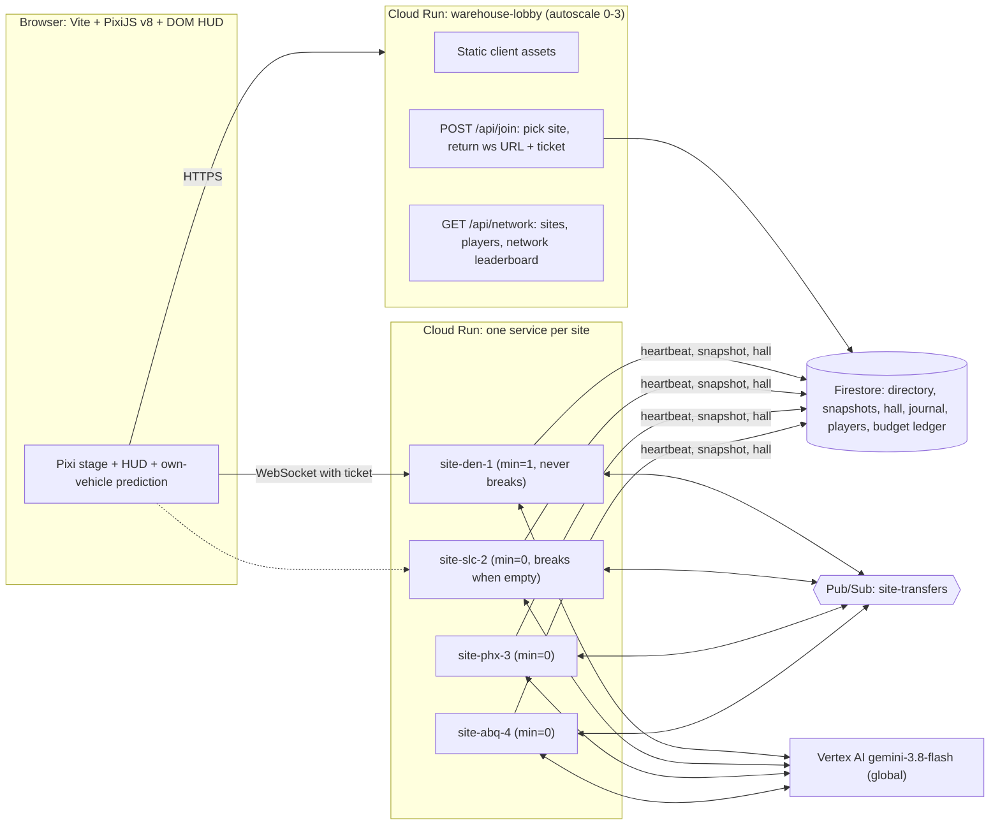
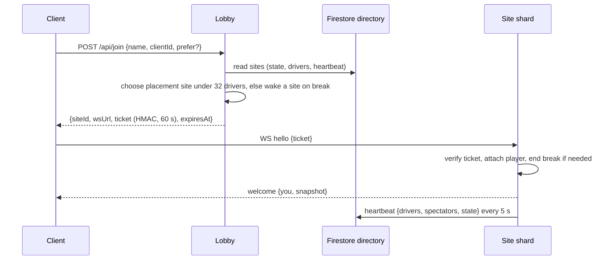
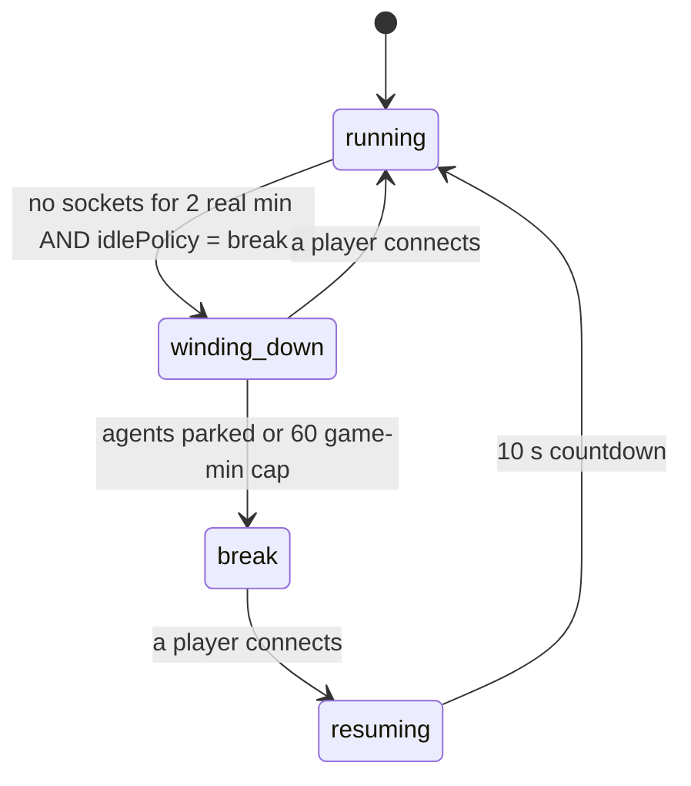

# Architecture: Warehouse Distribution Network

## Overview

The Warehouse game is an authoritative, always-running, multiplayer distribution network built on Google Cloud Run (`davenport-boutique`), Firestore, Pub/Sub, and Vertex AI (`gemini-3.8-flash`).

Rather than placing 128 forklifts onto a single gridlocked warehouse floor, the network shards players across **four regional warehouse sites** that trade freight pallets with one another:
- **DEN-1** (`site-den-1`): Home site, runs 24/7 (`min=1`, `IDLE_POLICY=run`, 20 default AI agents).
- **SLC-2** (`site-slc-2`): Overflow shard (`min=0`, `IDLE_POLICY=break`, 12 default AI agents).
- **PHX-3** (`site-phx-3`): Overflow shard (`min=0`, `IDLE_POLICY=break`, 12 default AI agents).
- **ABQ-4** (`site-abq-4`): Overflow shard (`min=0`, `IDLE_POLICY=break`, 12 default AI agents).

Each site shard runs an authoritative **10 Hz simulation loop** (`packages/sim`) on a dedicated Cloud Run service (`max=1` instance per site service) to guarantee a single authoritative world owner and stable address. Each shard supports up to **32 concurrent human/pilot drivers** (plus up to 28 AI agents, expanding up to `FLEET_CAP = 60` vehicles at facility Tier 6) and up to **300 total WebSocket connections** (including spectators).

---

## Sharding & Join Routing

Clients connect first to the public `warehouse-lobby` service (`min=0, max=3`), which serves the static Vite/PixiJS v8 frontend and coordinates shard placement via `POST /api/join`.

### Placement Order
When a player requests `POST /api/join { name, clientId, prefer? }`:
1. **Preferred site**: If `prefer` is specified and that site is live (heartbeat `< 15 s` old) with `< 32` drivers, place the player there.
2. **Fullest live site with room**: Otherwise, choose the live site with the highest driver count that still has `< 32` drivers, keeping active players together.
3. **Wake a site on break**: If all live sites are full (or none are live), pick the next site in `break` state and issue a ticket for its Cloud Run URL (waking the `min=0` Cloud Run instance on WebSocket connect).

### HMAC Join Tickets
- Tickets are signed by the lobby using an HMAC secret stored in Google Cloud Secret Manager (`ticket-hmac-key`), valid for **60 seconds**.
- Tickets bind `{ clientId, name, siteId, exp }` so clients cannot bypass the lobby's rate limits, name hygiene, or 32-driver shard capacity.
- On `SIGTERM` (e.g., Cloud Run instance rotation), a site writes a v5 snapshot to Firestore and closes all WebSockets with code `4001` ("reconnect via lobby"). Reconnecting clients pass `prefer: currentSiteId` to `/api/join` and seamlessly resume on the same shard.

---

## Factory Break State Machine

To control Vertex AI Gemini brain costs and allow overflow shards (`slc-2`, `phx-3`, `abq-4`) to scale to zero when unused, each site runs a phase state machine controlled by `IDLE_POLICY`:
- `IDLE_POLICY=run` (default for `den-1`): Never enters factory break; runs 24/7 at 1× speed.
- `IDLE_POLICY=break` (default for overflow shards): Transitions to break when empty.

| Phase | Behavior |
|---|---|
| `running` | Normal 10 Hz tick loop. Orders spawn, Gemini brains make asynchronous decisions, and shift timers advance. |
| `winding_down` | Triggered after 2 real minutes with 0 connected sockets when `IDLE_POLICY=break` (or via `setPhase`). No new orders are posted and no new Gemini brain requests are emitted. Agents finish deliveries currently on their forks, then park at chargers or the break room. If a player connects during `winding_down`, the site returns immediately to `running`. |
| `break` | Entered once all agents are parked or after a 60 game-minute wind-down cap. The game clock freezes (including order due times and the shift timer). The site persists a v5 snapshot to Firestore. Gemini brain spend drops to zero, and on `min=0` shards the Cloud Run instance can scale to zero. |
| `resuming` | When a player connects to a site in `break`, the shard restores its latest Firestore snapshot (if cold-starting), broadcasts a `phase` message ("Shift resumes in 10 s"), counts down 10 real seconds, and transitions to `running`. |

Every phase transition is recorded in the site's event log (e.g., `"Factory break started at 14:20, 0 players"`).

---

## Cross-Site Pallet Transfers

Sites are connected into a single distribution network via Google Cloud Pub/Sub (`site-transfers` topic):
1. **Outbound Transfer (`TransferOut`)**: A portion of generated orders at each site have `dest: { siteId }` (targeting a sibling site) and must be delivered to one of the two east **transfer bays** marked `→ network`.
2. **Pub/Sub Publish**: When a vehicle drops a transfer order at an east transfer bay, the sim emits a `TransferOut` event. The site server publishes a `Transfer` message to the `site-transfers` Pub/Sub topic with attribute `toSite = "<destSiteId>"`.
3. **Filtered Push Delivery**: Each site has a filtered Pub/Sub push subscription (`attributes.toSite = "den-1"`, etc.) that POSTs to the destination site's `/internal/transfer` endpoint using an OIDC token signed by `warehouse-pubsub-push@`. Failed deliveries retry with exponential backoff (`5s` to `60s`) up to 10 times before routing to `site-transfers-dlq`.
4. **Inbound Stowage (`receiveTransfer`)**: The receiving site verifies the OIDC token and calls `receiveTransfer(world, transfer)` idempotently by `transfer.id`. This spawns an inbound pallet at a west dock worth a **+5 point bonus** to whoever stows it. If the destination site is on break and scaled to zero, Pub/Sub holds the message or wakes the service cleanly without losing freight.

---

## Firestore Collections

All persistent state is stored in Firestore Native (`us-central1`):

| Collection / Document Path | Purpose & Lifecycle |
|---|---|
| `sites/{siteId}` | Live shard directory entry and heartbeat (updated every 5 s): `{ id, state, phase, drivers, spectators, tier, shipped, wsUrl, updatedAt }`. A site is considered live by the lobby only if `updatedAt` is `< 15 s` old. |
| `sites/{siteId}/snapshots/{snapshotId}` | Serialized v5 world state (`latest` document updated every 60 s, at shift change, on entering `break`, and on `SIGTERM`). |
| `sites/{siteId}/hall/{entryId}` | Site-specific Hall of Fame shift records and top scores. |
| `journal/{entryId}` | Decision and prompt-armor audit journal (`model`, `kind`, `latencyMs`, `tokens`, `reason`, or armor verdict). Configured with a **7-day Firestore TTL policy** on the `expireAt` field. |
| `players/{clientId}` | Cross-site player profile: `{ clientId, name, lifetimePoints, deliveries, transfersCompleted, strikes, mutedUntil, updatedAt }`. Shift points remain on the shard; lifetime stats follow `clientId` across site transfers. |
| `budget/{yyyy-mm-dd}` | Global daily Vertex AI spend ledger shared across all sites (`max $25.00/day` total, with a dedicated `$3.00/day` sub-slice for `nlCommand` typed orders). Sites reserve budget in 1-minute transactional blocks based on measured token prices. |
