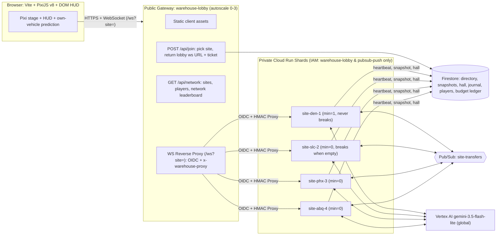
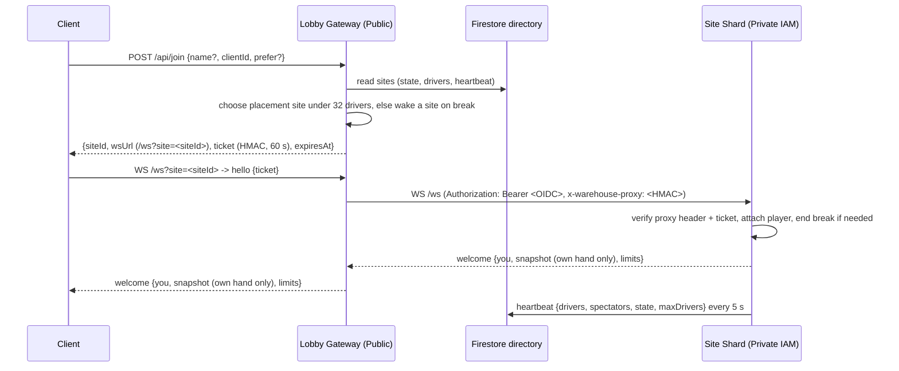
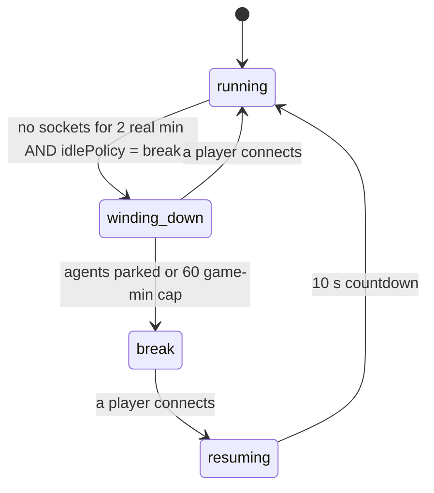

# Architecture: Warehouse Distribution Network

## Overview

The Warehouse game is an authoritative, always-running, multiplayer distribution network built on Google Cloud Run (`davenport-boutique`), Firestore, Pub/Sub, and Vertex AI (`gemini-3.5-flash-lite`).

Rather than placing 128 forklifts onto a single gridlocked warehouse floor, the network shards players across **four regional warehouse sites**, each with its own deterministic floor layout (`buildMap(tier, siteId)`), storage district arrangement, visual color palette, and 3D isometric cargo models (`SITE_THEMES`):
- **DEN-1 — Rocky Mountain Freight Hub** (`site-den-1`): Home site, runs 24/7 (`min=1`, `IDLE_POLICY=run`, 20 default AI agents). Classic 3-column × 2-band rack layout with banded freight cartons (`cargoKind: 'boxes'`, `DEN-*` SKUs).
- **SLC-2 — Bonneville Hydroponics & Nursery** (`site-slc-2`): Overflow shard (`min=0`, `IDLE_POLICY=break`, 12 default AI agents). 4-column × 2-band botanical conservatory layout with terracotta planters and living foliage (`cargoKind: 'plants'`, `BOT-*` SKUs).
- **PHX-3 — Sonoran Silicon & Solar Fab** (`site-phx-3`): Overflow shard (`min=0`, `IDLE_POLICY=break`, 12 default AI agents). 2-column × 3-band cleanroom wafer fab layout with FOUP wafer pods and cryo-cooling Dewars (`cargoKind: 'tech'`, `FAB-*` SKUs).
- **ABQ-4 — Mesa Verde Kiln & Artisan Works** (`site-abq-4`): Overflow shard (`min=0`, `IDLE_POLICY=break`, 12 default AI agents). Asymmetric 3-column × 3-band artisan kiln layout with adobe pottery and turquoise-glazed ceramics (`cargoKind: 'artisan'`, `KLN-*` SKUs).

Each site shard runs an authoritative **10 Hz simulation loop** (`packages/sim`) on a dedicated Cloud Run service (`max=1` instance per site service) to guarantee a single authoritative world owner and stable address. Each shard supports up to **32 concurrent human/pilot drivers** (plus up to 28 AI agents, expanding up to `FLEET_CAP = 60` vehicles at facility Tier 6) and up to **300 total WebSocket connections** (including spectators).

---

## Sharding, Gateway Isolation & Join Routing

Clients connect **exclusively** to the public `warehouse-lobby` service (`min=0, max=3`), which serves the static Vite/PixiJS v8 frontend, coordinates shard placement via `POST /api/join`, and reverse-proxies authenticated WebSocket streams (`/ws?site=<siteId>`) to the private regional site engines (`site-den-1`, `site-slc-2`, `site-phx-3`, `site-abq-4`). Backend site engines are never publicly exposed (`allUsers` is not granted `roles/run.invoker`) and require both a Google Cloud OIDC ID token and a domain-separated `x-warehouse-proxy` HMAC header.

### Delta fan-out

- **Light deltas** (9 of every 10 background ticks) are one shared JSON payload broadcast to every socket.
- **Full deltas** (1 Hz) share one serialized head plus shared `stats` (including the Strategy Board, recomputed at most once per second). The site then splices per-connection fields into each frame: the recipient's own card hand only; `seriesAppend` / `history` / `hall` sent incrementally against what that socket already has; and the sparse `heat` layer every 2 s, but only to sockets that sent `{type:'layers', traffic:true}`. Inspector detail (`tactics`, `path`, `decision`, …) rides on full deltas only. See `docs/protocol.md` §3.2.

### Placement Order & Cross-Site Surge Relocation
When a player requests `POST /api/join { name, clientId, prefer?, runMode? }`:
1. **Mode-Aware Shard Caps**:
   - **Free Range (`runMode === 'freerange'`)**: Soft-capped at **`FREE_RANGE_SOFT_CAP = 26`** drivers per shard so each shard reserves **4–6 open slots** for 5-Minute Blitz players. If all live shards have `>= 26` drivers, `/api/join` wakes a `'break'` shard first before falling back to any live shard with `< 32` drivers.
   - **5-Minute Blitz (`runMode === 'blitz'`, default)**: Routes to the warmest live shard with `< 30` drivers (`FREE_RANGE_HARD_CAP = 30`, or `< 32` when `prefer` is explicitly requested) so Blitz players always land in active, populated warehouses.
2. **Cross-Site Surge Relocation (`relocationOffer` → `acceptRelocation` → `relocateShard`)**:
   - Every 10 seconds (`checkSurgeRelocation`), if a shard's active human driver count reaches `>= 26` (`FREE_RANGE_SOFT_CAP`), the site server identifies a target shard with `< 20` drivers (or on `'break'`) and sends a non-intrusive `{ type: 'relocationOffer', toSiteId, toSiteName, bonusPts: 75, expiresAt }` to up to `activeDrivers - 24` eligible `'freerange'` human drivers (90 s cooldown per player).
   - Accepting the offer (`{ type: 'acceptRelocation', toSiteId }`) immediately awards **`+75` Surge Relocation Bonus points** (`RELOCATION_BONUS_PTS = 75`), persists them to `players/{clientId}`, mints a signed HMAC carry-over `ticket` containing `{ carryPts, carryDeliveries, carryStreak, carryCards, relocationBonus: 75, runMode: 'freerange' }`, and sends `{ type: 'relocateShard', siteId, wsUrl, ticket, bonusPts: 75 }`.
   - The client seamlessly reconnects to the target shard using the pre-minted ticket, and the receiving shard restores the driver's score, deliveries, streak, and active/completed skill cards onto their new vehicle.

### HMAC Join Tickets & Gateway Proxy Headers
- Join tickets are signed by the lobby (and by site shards on surge relocation) using an HMAC secret stored in Google Cloud Secret Manager (`ticket-hmac-key`), valid for **60 seconds**, with domain separation (`warehouse-join-ticket-v1:`).
- Tickets bind `{ clientId, name, siteId, exp }` (plus optional surge relocation carry-over fields) so clients cannot bypass the lobby's rate limits, name hygiene, or 32-driver shard capacity.
- When proxying a WebSocket upgrade to a backend site engine, `warehouse-lobby` attaches an OIDC ID token (`Authorization: Bearer <token>`) for Cloud Run IAM (`roles/run.invoker`) plus a short-lived `x-warehouse-proxy` header signed with domain separation (`warehouse-proxy-header-v1:`). Backend site engines reject any direct connections or debug API probes that lack proxy authentication.
- On `SIGTERM` (e.g., Cloud Run instance rotation), a site writes a v5 snapshot to Firestore and closes all WebSockets with code `4001` ("reconnect via lobby"). Reconnecting clients pass `prefer: currentSiteId` to `/api/join` and seamlessly resume on the same shard.

---

## Factory Break State Machine

To control Vertex AI Gemini brain costs and allow overflow shards (`slc-2`, `phx-3`, `abq-4`) to scale to zero when unused, each site runs a phase state machine controlled by `IDLE_POLICY`:
- `IDLE_POLICY=run` (default for `den-1`): Never enters factory break; runs 24/7 at 1× speed.
- `IDLE_POLICY=break` (default for overflow shards): Transitions to break when empty.

| Phase | Behavior |
|---|---|
| `running` | Normal 10 Hz tick loop. Orders spawn, Gemini brains make asynchronous decisions, and shift timers advance. |
| `winding_down` | Triggered after 2 real minutes with 0 connected sockets when `IDLE_POLICY=break` (or via `setPhase`). No new orders are posted and no new Gemini brain requests are emitted. Agents finish deliveries currently on their forks, then park at chargers or the break room. If a player connects during `winding_down`, the site returns immediately to `running`. |
| `break` | Entered once all agents are parked or after a 60 game-minute wind-down cap. The game clock freezes (including order due times and the shift timer). The site persists a v5 snapshot to Firestore. Gemini brain spend drops to zero, and on `min=0` shards the Cloud Run instance can scale to zero. |
| `resuming` | When a player connects to a site in `break`, the shard restores its latest Firestore snapshot (if cold-starting), broadcasts a `phase` message ("Shift resumes in 10 s"), counts down 10 real seconds, and transitions to `running`. |

Every phase transition is recorded in the site's event log (e.g., `"Factory break started at 14:20, 0 players"`).

---

## Cross-Site Pallet Transfers

Sites are connected into a single distribution network via Google Cloud Pub/Sub (`site-transfers` topic):
1. **Outbound Transfer (`TransferOut`)**: A portion of generated orders at each site have `dest: { siteId }` (targeting a sibling site) and must be delivered to one of the two east **transfer bays** marked `→ network`.
2. **Pub/Sub Publish**: When a vehicle drops a transfer order at an east transfer bay, the sim emits a `TransferOut` event. The site server publishes a `Transfer` message to the `site-transfers` Pub/Sub topic with attribute `toSite = "<destSiteId>"`.
3. **Filtered Push Delivery**: Each site has a filtered Pub/Sub push subscription (`attributes.toSite = "den-1"`, etc.) that POSTs to the destination site's `/internal/transfer` endpoint using an OIDC token signed by `warehouse-pubsub-push@`. Failed deliveries retry with exponential backoff (`5s` to `60s`) up to 10 times before routing to `site-transfers-dlq`.
4. **Inbound Stowage (`receiveTransfer`)**: The receiving site verifies the OIDC token and calls `receiveTransfer(world, transfer)` idempotently by `transfer.id`. This spawns an inbound pallet at a west dock worth a **+5 point bonus** to whoever stows it. If the destination site is on break and scaled to zero, Pub/Sub holds the message or wakes the service cleanly without losing freight.

---

## Firestore Collections

All persistent state is stored in Firestore Native (`us-central1`):

| Collection / Document Path | Purpose & Lifecycle |
|---|---|
| `sites/{siteId}` | Live shard directory entry and heartbeat (updated every 5 s): `{ id, state, phase, drivers, spectators, tier, shipped, wsUrl, updatedAt }`. A site is considered live by the lobby only if `updatedAt` is `< 15 s` old. |
| `sites/{siteId}/snapshots/{snapshotId}` | Serialized v5 world state (`latest` document updated every 60 s, at shift change, on entering `break`, and on `SIGTERM`). |
| `sites/{siteId}/hall/{entryId}` | Site-specific Hall of Fame shift records and top scores. |
| `journal/{entryId}` | Decision and prompt-armor audit journal (`model`, `kind`, `latencyMs`, `tokens`, `reason`, or armor verdict). Configured with a **7-day Firestore TTL policy** on the `expireAt` field. |
| `players/{clientId}` | Cross-site player profile: `{ clientId, name, lifetimePoints, deliveries, transfersCompleted, strikes, mutedUntil, updatedAt }`. Shift points remain on the shard; lifetime stats follow `clientId` across site transfers. |
| `budget/{yyyy-mm-dd}` | Global daily Vertex AI spend ledger shared across all sites (`max $12.50/day` agent cap, with a dedicated `$1.50/day` cap for `nlCommand` typed orders). Sites reserve budget in 1-minute transactional blocks based on measured token prices. |

---

## AI Concepts & Client Intro Briefing

When the client loads (`apps/client/src/ui/help.ts`), the **Intro Page** (`#help`) opens by default (`shouldShowHelpOnBoot`). Its default **How to Play** tab is three steps and a big **Start driving** button. The AI architecture is in a separate **The AI Inside** tab:
1. **Hybrid Neuro-Symbolic Agent Control**: Separates high-level tactical reasoning (`gemini-3.5-flash-lite` structured JSON decisions for `tactics`, `cards`, and `nlCommand` / `a2uiScreen` routing) from deterministic 10 Hz physics, occupancy reservation, and A* pathfinding (`packages/sim`).
2. **Multi-Agent Strategy Evaluation**: Continuously benchmarks AI strategy cohorts (`Balanced`, `Speed First`, `Safety First`, `Zone Specialist`) alongside `Human Drivers` on the live Strategy Board (`/hr`, `On-time %`, `Incidents`, `kWh/order`) and `Value Created` chart.
3. **Real-Time Observability & Cost/Security Guardrails**: Exposes every agent's active thought reason, path, and token/latency metrics in the Inspector and History Drawer (`Brain log`), while protecting inference via Model Armor prompt screening, per-player governance cooldowns, and the Firestore daily budget ledger.

