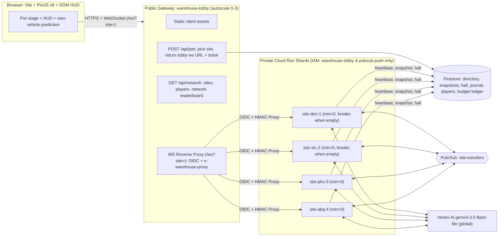
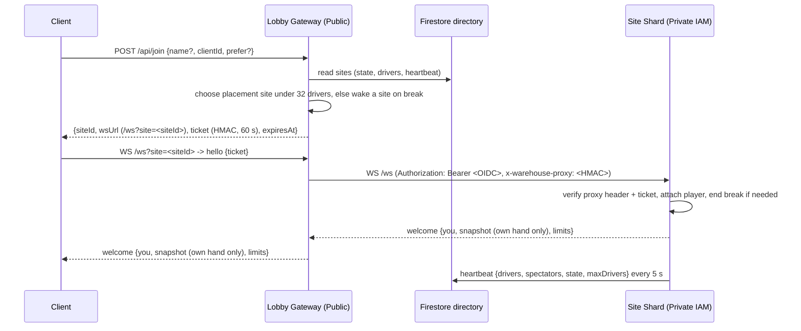
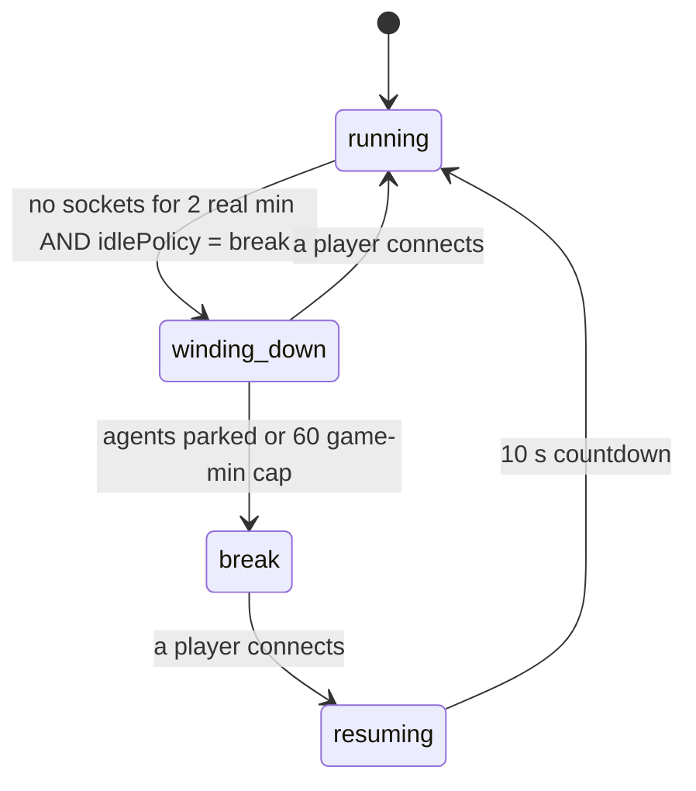

# Architecture: Freight Floor

## Overview

**Freight Floor** (`freightfloor.com` · `https://github.com/davenportjw/freightfloor`) is an authoritative, always-running, multiplayer distribution network built on Google Cloud Run (`davenporter-freightfloor`), Firestore, Pub/Sub, and Vertex AI (`gemini-3.5-flash-lite`).

Rather than placing 128 forklifts onto a single gridlocked warehouse floor, the network shards players across **four regional warehouse sites**, each with its own deterministic floor layout (`buildMap(tier, siteId)`), storage district arrangement, visual color palette, and 3D isometric cargo models (`SITE_THEMES`):
- **DEN-1 — Rocky Mountain Freight Hub** (`site-den-1`): Primary home site (`min=0`, `IDLE_POLICY=break`, 20 default AI agents; wakes on demand when a player joins and scales to zero when empty). Classic 3-column × 2-band rack layout with banded freight cartons (`cargoKind: 'boxes'`, `DEN-*` SKUs).
- **SLC-2 — Bonneville Hydroponics & Nursery** (`site-slc-2`): Overflow shard (`min=0`, `IDLE_POLICY=break`, 12 default AI agents). 4-column × 2-band botanical conservatory layout with terracotta planters and living foliage (`cargoKind: 'plants'`, `BOT-*` SKUs).
- **PHX-3 — Sonoran Silicon & Solar Fab** (`site-phx-3`): Overflow shard (`min=0`, `IDLE_POLICY=break`, 12 default AI agents). 2-column × 3-band cleanroom wafer fab layout with FOUP wafer pods and cryo-cooling Dewars (`cargoKind: 'tech'`, `FAB-*` SKUs).
- **ABQ-4 — Mesa Verde Kiln & Artisan Works** (`site-abq-4`): Overflow shard (`min=0`, `IDLE_POLICY=break`, 12 default AI agents). Asymmetric 3-column × 3-band artisan kiln layout with adobe pottery and turquoise-glazed ceramics (`cargoKind: 'artisan'`, `KLN-*` SKUs).

Each site shard runs an authoritative **10 Hz simulation loop** (`packages/sim`) on a dedicated Cloud Run service (`max=1` instance per site service) to guarantee a single authoritative world owner and stable address. Each shard supports up to **32 concurrent human/pilot drivers** (plus up to 28 AI agents, expanding up to `FLEET_CAP = 60` vehicles at facility Tier 6) and up to **300 total WebSocket connections** (including spectators).

**Brain scheduling.** `AgentBrainScheduler.drainQueue` dispatches each `DecisionRequest` into its own concurrency slot, up to `MAX_CONCURRENT_BRAIN_CALLS`. A slot is freed as soon as its request settles. The background tick calls `drainQueue(..., { wait: false })`, so a slow or hung Gemini call never blocks other agents' decisions or the next tick. Each Vertex call:
- has a hard 4 s abort (`BRAIN_CALL_TIMEOUT_MS`);
- sends the per-kind `responseSchema`;
- gets at most `BRAIN_MAX_ATTEMPTS = 2` attempts.

A failure in the budget check or prompt rendering is recorded as a brain failure (`brainError`) rather than as an unhandled rejection. `GEMINI_MODEL` is validated at boot (`resolveGeminiModel`) against `ALLOWED_GEMINI_MODELS`. An unknown model fails startup.

---

## Sharding, Gateway Isolation & Join Routing

Clients connect **exclusively** to the public `warehouse-lobby` service (`min=0, max=3`), which serves the static Vite/PixiJS v8 frontend, coordinates shard placement via `POST /api/join`, and reverse-proxies authenticated WebSocket streams (`/ws?site=<siteId>`) to the private regional site engines (`site-den-1`, `site-slc-2`, `site-phx-3`, `site-abq-4`). Backend site engines are never publicly exposed (`allUsers` is not granted `roles/run.invoker`) and require both a Google Cloud OIDC ID token and a domain-separated `x-warehouse-proxy` HMAC header.

### Delta fan-out

- **Light deltas** (9 of every 10 background ticks) are one shared JSON payload broadcast to every socket.
- **Full deltas** (1 Hz) share one serialized head plus shared `stats` (including the Strategy Board, recomputed at most once per second). The site then splices per-connection fields into each frame: the recipient's own card hand only; `seriesAppend` / `history` / `hall` sent incrementally against what that socket already has; and the sparse `heat` layer every 2 s, but only to sockets that sent `{type:'layers', traffic:true}`. Inspector detail (`tactics`, `path`, `decision`, …) rides on full deltas only. See `docs/protocol.md` §3.2.

### Placement Order & Cross-Site Surge Relocation
When a player requests `POST /api/join { name, clientId, prefer?, runMode? }`:
1. **Mode-Aware Shard Caps**:
   - **Free Range (`runMode === 'freerange'`)**: Soft-capped at **`FREE_RANGE_SOFT_CAP = 26`** drivers per shard so each shard reserves **4–6 open slots** for 3-Minute Blitz players. If all live shards have `>= 26` drivers, `/api/join` wakes a `'break'` shard first before falling back to any live shard with `< 32` drivers.
   - **3-Minute Blitz (`runMode === 'blitz'`, default)**: Routes to the warmest live shard with `< 30` drivers (`FREE_RANGE_HARD_CAP = 30`, or `< 32` when `prefer` is explicitly requested) so Blitz players always land in active, populated warehouses.
2. **Cross-Site Surge Relocation (`relocationOffer` → `acceptRelocation` → `relocateShard`)**:
   - Every 10 seconds (`checkSurgeRelocation`), if a shard's active human driver count reaches `>= 26` (`FREE_RANGE_SOFT_CAP`), the site server identifies a target shard with `< 20` drivers (or on `'break'`) and sends a non-intrusive `{ type: 'relocationOffer', toSiteId, toSiteName, bonusPts: 75, expiresAt }` to up to `activeDrivers - 24` eligible `'freerange'` human drivers (90 s cooldown per player).
   - Accepting the offer (`{ type: 'acceptRelocation', toSiteId }`) immediately awards **`+75` Surge Relocation Bonus points** (`RELOCATION_BONUS_PTS = 75`), persists them to `players/{clientId}`, mints a signed HMAC carry-over `ticket` containing `{ carryPts, carryDeliveries, carryStreak, carryCards, relocationBonus: 75, runMode: 'freerange' }`, and sends `{ type: 'relocateShard', siteId, wsUrl, ticket, expiresAt, bonusPts: 75 }`.
   - The client seamlessly reconnects to the target shard using the pre-minted ticket, and the receiving shard restores the driver's score, deliveries, streak, and active/completed skill cards onto their new vehicle.

### HMAC Join Tickets & Gateway Proxy Headers
- Join tickets are signed by the lobby (and by site shards on surge relocation) using an HMAC secret stored in Google Cloud Secret Manager (`ticket-hmac-key`), valid for **60 seconds**, with domain separation (`warehouse-join-ticket-v1:`).
- Tickets bind `{ clientId, name, siteId, exp }` (plus optional surge relocation carry-over fields) so clients cannot bypass the lobby's rate limits, name hygiene, or 32-driver shard capacity.
- When proxying a WebSocket upgrade to a backend site engine, `warehouse-lobby` attaches an OIDC ID token (`Authorization: Bearer <token>`) for Cloud Run IAM (`roles/run.invoker`) plus a short-lived `x-warehouse-proxy` header signed with domain separation (`warehouse-proxy-header-v1:`). Backend site engines reject any direct connections or debug API probes that lack proxy authentication.
- On `SIGTERM` (e.g., Cloud Run instance rotation), a site writes a v5 snapshot to Firestore and closes all WebSockets with code `4001` ("reconnect via lobby"). Reconnecting clients pass `prefer: currentSiteId` to `/api/join` and seamlessly resume on the same shard.
- Client reconnects (`apps/client/src/net.ts`) use exponential backoff (500 ms doubling to 8 s) with ±30% jitter (`backoffDelay`, `RECONNECT_JITTER`) so a fleet of clients dropped together does not reconnect in lockstep. The attempt counter resets only when a `welcome` arrives (a socket that opens and is immediately closed keeps backing off). Policy closes — `4003` (bad/consumed ticket, wrong site, rejected name, auth timeout) and `4008` (site full) — wait at least `POLICY_CLOSE_RETRY_MS` (15 s) and say why ("Site full: …" / "Connection rejected: …"). Overlapping joins (a site switch while a reconnect is in flight, a rename, Run again) are sequenced: each `join()` aborts the previous lobby request, a superseded join rejects with `StaleJoinError` (ignored by callers), and only the newest join opens a socket. A join for a different site (switch, `relocateShard` ticket) always opens a fresh socket; the client re-sends `hello` on an already-open socket only when it is for the same site.
- A site socket still in `CONNECTING` after `CONNECT_TIMEOUT_MS` (10 s) — a handshake that never reaches the server — is abandoned and retried the same way, so the HUD shows "Retrying in Ns · Connecting to DEN-1 timed out" instead of hanging on "Connecting…".

### FIFO Waiting Queue, Seat Claim Leases, Driver Eviction & Dynamic Overflow Scaling
When all live shards reach their 32-driver cap (128+ concurrent players across the 4 baseline shards), the lobby and site servers coordinate fair seat rotation and elastic overflow capacity:
1. **FIFO Waiting Queue & Spectator Placement (`POST /api/join`, `GET /api/queue`, `POST /api/queue/claim`, `POST /api/queue/leave`)**:
   - When every live shard is at capacity, `POST /api/join` connects the player immediately as a spectator on a live shard (`role: 'spectator'`) and returns a `queue` status payload (`state: 'queued'`, `position`, `etaSec`, `queueSize`).
   - While queued, the client polls `GET /api/queue?clientId=<id>` every 3 seconds (`QUEUE_POLL_MS = 3_000`) to refresh queue position and estimated wait time. Players can leave the queue via `POST /api/queue/leave`.
2. **20-Second Seat Claim Leases (`state: 'ready'`)**:
   - As driver slots open on any shard, the lobby advances the FIFO queue and grants the head-of-line player a **20-second seat reservation lease** (`state: 'ready'`, `assignedSiteId`, `leaseExpiresAt`).
   - If the player has **Auto-join when ready** enabled (`autoClaimSeat`, default `true`) or clicks **🚜 Take Driver Seat Now `F`**, the client calls `POST /api/queue/claim` to mint a driver join ticket (`role: 'driver'`) and switches directly into the reserved cockpit. Unclaimed leases expire after 20 seconds and pass to the next queued spectator.
3. **Automatic Post-Run & AFK Driver Eviction (`runEvicted`)**:
   - **Post-Run Slot Release**: When a driver's 3-Minute Blitz run finishes (`reason: 'run_complete'`), the site server immediately despawns their temporary player vehicle (`DRV-*`), releases their driver slot (`drivers` count decrements immediately), converts their connection to spectator mode, and sends `{ type: 'runEvicted', vid, reason: 'run_complete' }`. Starting another run (`retryNewRun`) requests a fresh seat via `POST /api/join` (`role: 'driver'`), placing the player at the back of the FIFO waiting line if all shards are full.
   - **60-Second AFK Timeout**: Any human driver who sends no steering, interaction, or command input for **60 seconds** is evicted from their driver seat (`reason: 'afk_timeout'`), freeing the slot for waiting players.
   - **Free-Range 5-Minute Contention Lease**: Under queue contention (`drivers >= 28`), Free-Range sessions are bounded by a **5-minute contention lease** (`reason: 'freerange_lease_expired'`) so a single sandbox driver cannot hold a cockpit indefinitely while others are waiting in line.
4. **Dynamic Overflow Warehouse Scaling (`MAX_WAREHOUSES`, `QUEUE_SCALE_THRESHOLD`)**:
   - Configured via `MAX_WAREHOUSES` (default `8`) and `QUEUE_SCALE_THRESHOLD` (default `8`) on `warehouse-lobby`.
   - When the waiting queue reaches `QUEUE_SCALE_THRESHOLD` and additional overflow shards are configured below `MAX_WAREHOUSES`, the network dynamically activates overflow warehouse shards (such as `den-2`, `slc-3`, `phx-4`, `abq-5`). Overflow shards inherit their regional base archetype's layout, visual palette, and cargo specialty via `getCanonicalBaseSiteId(siteId)`.
5. **Multi-Instance Queue Consistency (`FirestoreLobbyStore.runQueueTransaction`)**:
   - Every queue mutation (enqueue, prune, seat allocation, lease claim, direct driver admission, leave, status heartbeat) runs inside one Firestore transaction that reads the `queue_meta/allocator` ledger doc plus the whole `queue` collection, buffers writes, and bumps the ledger `version` when anything changed. Concurrent lobby instances therefore conflict and retry instead of double-allocating the last seat; queue `position`/`totalQueued` come from the transaction snapshot.
   - **Seat holds**: a lease claim or direct driver admission leaves a `state: 'claimed'` queue entry with `leaseExpiresAt = now + SEAT_HOLD_MS` (45 s). Holds count against a site's capacity only until the driver actually connects: queue prune deletes a hold as soon as a site heartbeat written after the hold was granted (`updatedAt >= leaseExpiresAt - SEAT_HOLD_MS`) lists the driver in its connected roster (`StoredSiteDoc.connectedDriverClientIds` — the raw heartbeat list, excluding the lobby's own pending assignments). The full 45 s window applies only to no-shows. A lagging pre-grant heartbeat (e.g. the player's previous run) never releases a hold. Claimed entries are invisible to queue status (reported as `expired`).
   - Firestore queue read/transaction failures are surfaced as HTTP `503 { error: 'queue_unavailable' }`; an empty queue collection is authoritative, and there is no silent in-memory fallback.

---

## Factory Break State Machine

To control Vertex AI Gemini brain costs and allow overflow shards (`slc-2`, `phx-3`, `abq-4`) to scale to zero when unused, each site runs a phase state machine controlled by `IDLE_POLICY`:
- `IDLE_POLICY=run` (default for `den-1`): Never enters factory break; runs 24/7 at 1× speed.
- `IDLE_POLICY=break` (default for overflow shards): Transitions to break when empty.

| Phase | Behavior |
|---|---|
| `running` | Normal 10 Hz tick loop. Orders spawn, Gemini brains make asynchronous decisions, and shift timers advance. |
| `winding_down` | Triggered after 2 real minutes with 0 connected sockets when `IDLE_POLICY=break` (or via `setPhase`). No new orders are posted and no new Gemini brain requests are emitted. Agents finish deliveries currently on their forks, then park at chargers or the break room. If a player connects during `winding_down`, the site returns immediately to `running`. |
| `break` | Entered once all agents are parked or after a 60 game-minute wind-down cap. The game clock freezes (including order due times and the shift timer). The site persists a v5 snapshot to Firestore. Gemini brain spend drops to zero, and on `min=0` shards the Cloud Run instance can scale to zero. |
| `resuming` | When a player connects to a site in `break`, the shard restores its latest Firestore snapshot (if cold-starting), broadcasts a `phase` message ("Shift resumes in 10 s"), counts down 10 real seconds, and transitions to `running`. |

Every phase transition is recorded in the site's event log (e.g., `"Factory break started at 14:20, 0 players"`).

---

## Cross-Site Pallet Transfers

Sites are connected into a single distribution network via Google Cloud Pub/Sub (`site-transfers` topic):
1. **Outbound Transfer (`TransferOut`)**: A portion of generated orders at each site have `dest: { siteId }` (targeting a sibling site) and must be delivered to one of the two east **transfer bays** marked `→ network`.
2. **Pub/Sub Publish**: When a vehicle drops a transfer order at an east transfer bay, the sim emits a `TransferOut` event. The site server publishes a `Transfer` message to the `site-transfers` Pub/Sub topic with attribute `toSite = "<destSiteId>"`. A transfer leaves `world.outboundTransfers` only after its publish succeeds. If a publish fails, the transfer stays at the head of the queue and is retried on a later tick, so freight is never lost. Only one publish loop runs at a time (`transferPublishInFlight`).
3. **Filtered Push Delivery**: Each site has a filtered Pub/Sub push subscription (`attributes.toSite = "den-1"`, etc.) that POSTs to the destination site's `/internal/transfer` endpoint using an OIDC token signed by `warehouse-pubsub-push@`. Failed deliveries retry with exponential backoff (`5s` to `60s`) up to 10 times before routing to `site-transfers-dlq`.
4. **Inbound Stowage (`receiveTransfer`)**: The receiving site verifies the OIDC token (`google-auth-library` `verifyIdToken`). If Cloud Run IAM has already verified the token and stripped its signature (`SIGNATURE_REMOVED_BY_GOOGLE`), the site checks the claims only. The token's audience must be `TRANSFER_PUSH_AUDIENCE` or `https://<host>/internal/transfer`, and its `email` must equal `PUBSUB_PUSH_SERVICE_ACCOUNT` with `email_verified`. The site then calls `receiveTransfer(world, transfer)` idempotently by `transfer.id`. The dedupe set `world.receivedTransferIds` is FIFO-capped at `MAX_RECEIVED_TRANSFER_IDS = 2000`; it is pruned after each receive and before each snapshot. This spawns an inbound pallet at a west dock worth a **+5 point bonus** to whoever stows it. If the destination site is on break and scaled to zero, Pub/Sub holds the message or wakes the service cleanly without losing freight.

---

## Firestore Collections

All persistent state is stored in Firestore Native (`us-central1`):

| Collection / Document Path | Purpose & Lifecycle |
|---|---|
| `sites/{siteId}` | Live shard directory entry and heartbeat (updated every 5 s): `{ id, state, phase, drivers, spectators, tier, shipped, wsUrl, updatedAt }`. A site is considered live by the lobby only if `updatedAt` is `< 15 s` old. |
| `sites/{siteId}/snapshots/{snapshotId}` | Serialized v5 world state (`latest` document updated every 60 s, at shift change, on entering `break`, and on `SIGTERM`). |
| `sites/{siteId}/hall/{entryId}` | Site-specific Hall of Fame shift records and top scores. |
| `journal/{entryId}` | Decision and prompt-armor audit journal (`model`, `kind`, `latencyMs`, `tokens`, `reason`, or armor verdict). Configured with a **7-day Firestore TTL policy** on the `expireAt` field. |
| `players/{clientId}` | Cross-site player profile: `{ clientId, name, lifetimePoints, deliveries, transfersCompleted, strikes, mutedUntil, updatedAt, resumeTokenHash? }`. Shift points remain on the shard; lifetime stats follow `clientId` across site transfers. `resumeTokenHash` is the SHA-256 of the player's resume code (written/backfilled by the lobby) used for cross-device resume lookup. |
| `queue/{clientId}` | Lobby FIFO seat queue entries (`queued`, `ready` lease, or `claimed` seat hold). Mutated only inside Firestore transactions. |
| `queue_meta/allocator` | Queue allocator ledger (`version`, `updatedAt`) read and bumped by every queue transaction so concurrent lobby instances serialize. |
| `budget/{yyyy-mm-dd}` | Global daily Vertex AI spend ledger shared across all sites (`max $12.50/day` agent cap, with a dedicated `$1.50/day` cap for `nlCommand` typed orders). `CloudPersistenceStore` buffers usage in memory and writes it every 10 s (`BUDGET_FLUSH_INTERVAL_MS`) with `FieldValue.increment` (merge set). It runs no per-call transaction and flushes again on shutdown. `checkBudget` reads a cached doc (refreshed in the background, `BUDGET_CACHE_TTL_MS = 10 s`) plus this instance's unflushed delta. Usage is recorded once per decision, after the retry loop, and a ledger failure never re-calls Gemini. |

---

## Hybrid 2:1 Isometric Baked Sprite Atlas & Enhanced 3D Renderer

The client renderer (`apps/client/src/renderer.ts`, `apps/client/src/render/*`) and deterministic asset generator (`tools/sprites/src/index.ts`, `@warehouse/sprites` v2) use a **hybrid 2:1 isometric rendering pipeline** (`TW = 64, TH = 32` per world tile):

1. **96×96 Isometric Baked Sprite Atlas (`atlas.png` + `atlas.json`, `CELL = 96`, `COLS = 24`)**:
   - Generated deterministically by `@warehouse/sprites` using a pure-TypeScript 3D isometric software rasterizer (`isoBox`, `isoOrientedBox`, `isoCyl`, `isoContactShadow`) with top/east/south face shading, specular top-edge bevel highlights, and ground contact shadows anchored at `{ x: 0.5, y: 0.62 }`.
   - Pre-renders **576 vehicle cells** (`3` vehicle types × `6` strategy/human tints × `2` load states × `16` headings), **20 regional cargo pallet sprites** (`cargo_<boxes|plants|tech|artisan>_<0|1|2|p0|net>`), **8 regional conveyor tote sprites** (`conv_<boxes|plants|tech|artisan>_<0|1>`), and static environment props (`charger`, `charger_busy`, `cone`, racks, bays, spills, and district floors).
2. **Real-Time Hybrid Canvas2D Composition (`Painter`)**:
   - In the browser, `WarehouseRenderer` asynchronously loads `/assets/atlas.json` and `/assets/atlas.png` into `Painter`.
   - Repeated static/discrete world props—floor & fork-carried regional pallets (`drawCargoItem`), moving conveyor totes (`drawConveyorItem`), charger pedestals (`charger` / `charger_busy`), and traffic cones (`cone`)—are blitted directly from the pre-rendered 96×96 isometric atlas (`Painter.sprite()`), scaled by camera zoom (`96 * cam.zoom`).
   - Forklifts (`drawVehicle` / `vehicleParts`) render with continuous 360° heading interpolation (`oBox`) and animated fork height (`v.fork`), enriched with 3D tires/hubcaps, rear counterweight vents, operator seat & steering column, roof safety strobe beacon, dual mast hydraulic cylinders, fork carriageplate, and top-face specular bevel highlights (`Painter.oBox`, `Painter.aaBox`, `Painter.cyl`).
   - In headless unit tests or before the atlas image finishes loading, `Painter.sprite()` returns `false` and transparently falls back to the procedural 3D primitive models.
   - **Selectable Driving Camera Orientation (`DriveCameraMode`: `'fixed'` vs. `'headingUp'`, `render/iso.ts`)**: `Camera` supports an optional world-plane rotation angle `rot` (`rotateGrid`, `isoDepth`, `headingUpRotation(angle) = -3π/4 - angle`). In `'fixed'` mode (`rot = 0`), the warehouse floor stays locked in its standard isometric aspect. In `'headingUp'` mode (`R` hotkey, `#dash` toggle, `#help` Intro toggle, `☰ → View` / `Settings → Camera`, `?driveCamera=headingUp`, `localStorage['warehouse.camera.driveMode']`), `WarehouseRenderer.render` smoothly rotates the floor plane around the driven forklift's world focus point so the forklift always drives straight up (`-sy`) on screen, anchors it in the lower quarter of the viewport (`anchorOn`, `HEADING_UP_ANCHOR_Y = 0.78`, smoothed `followAnchorY`) for a look-ahead view, while keeping all vertical `z` extrusions upright and depth-sorting scene items, racks, trucks, and vehicle sub-parts by rotated `isoDepth`.
   - East shipping-bay semi trucks (`render/trucks.ts`: `rigParts`, `drawDockRig`) are procedural tractor + 53' trailer rigs (ribbed roof, livery stripe, marker lamps, tandem axles, conventional cab with stacks, grille and headlamps; indigo livery for NET transfer bays) with dock bumpers, a hazard-striped leveller and wheel chocks while parked. The sim's 3-minute swap window (`bay.departUntil = t + 3`) is mapped by the pure `dockTruckFrame()` to *departing* (rig pulls forward, headlight pool, exhaust) → *empty* → *arriving* (next rig reverses in with reverse-lamp pool, hazard beacon and brake lights), settling exactly when the bay reopens. World time is smoothed per frame by `SimClock` so rigs glide rather than step at 10 Hz. The trailer fill bar shows only while docked.
   - West receiving docks use the same rig mirrored (`dir: -1`, `kind: 'receive'`, teal/blue livery), so the camera sees the trailer's rear roll-up door rather than the cab. The sim has no inbound-trailer cycle, so these rigs stay parked; they do not animate in or out. The door is driven by real state: it opens (`doorPallets`) to show up to 3 pallets when inbound transfer orders are waiting at that dock (`order.slot.rackId === dock.id`, not yet picked or done), and stays closed otherwise.

---

## AI Concepts & Client Intro Briefing

When the client loads (`apps/client/src/ui/help.ts`), the **Intro Page** (`#help`) opens by default (`shouldShowHelpOnBoot`), featuring a GitHub repository icon link (`.intro-github-link` → `https://github.com/davenportjw/freightfloor`) in its header and a "Powered by Davenporter" pill link (`.intro-powered-link` → `https://davenporter.com`) in its footer. Its default **How to Play** tab is three steps and a big **Enter Floor** button. The AI architecture is in the **The AI Inside** and **Decision Lifecycle** tabs:
1. **Hybrid Neuro-Symbolic Agent Control**: Separates high-level tactical reasoning (`gemini-3.5-flash-lite` structured JSON decisions for `tactics`, `cards`, and `nlCommand` / `a2uiScreen` routing) from deterministic 10 Hz physics, occupancy reservation, and A* pathfinding (`packages/sim`).
2. **Multi-Agent Strategy Evaluation**: Continuously benchmarks the AI driving styles (sim `Archetype`: `Sprinter`, `Steady`, `Batcher`, `Opportunist`, `Strategist`) alongside `Human` drivers on **Team Standings** (☰ → Team Standings / `B`; data from `stats.board`, ranked by orders/hr per truck) and the `Value Created` chart.
3. **Real-Time Observability & Cost/Security Guardrails**: Exposes every agent's active thought reason, path, and token/latency metrics in the Inspector and History Drawer (`Brain log`), while protecting inference via Model Armor prompt screening, per-player governance cooldowns, and the Firestore daily budget ledger.

---

## Client HUD (v3) Module Layout

The client (`apps/client`, vanilla TypeScript + Canvas2D, Vite) has two HUD layouts, **Drive** and **Floor**, chosen by `ui/mode.ts` (`hudMode`, `activeOverlay`). See [gameplay.md § 7](gameplay.md#7-client-ui--controls) for the player-facing description. Each HUD region is one module mounted by `main.ts` on a fixed element id. Modules are re-rendered from `ClientStore` (`state.ts`) through `KeyedView`, so the DOM only changes when the view model changes. Interactive buttons use `bindTapClick` (`ui/dom.ts`) with `touch-action: manipulation` so iOS Safari / coarse-pointer touch taps activate cleanly on `pointerup` (with scroll-slop tolerance and synthetic `click` deduplication), `createFocusTrap` (`ui/focusTrap.ts`) skips programmatic initial focus on coarse pointers, and dismissing the `#help` Intro modal auto-keeps the initial contract offer so players are never blocked by two sequential intro modals (`#help` → `#pickSheet`).

| Module | Element | Role |
|---|---|---|
| `ui/runCapsule.ts` | `#run` | Drive: Blitz clock / PPM · points + streak · combo pips · position ▲/▼ |
| `ui/objective.ts` | `#objective`, `#fare`, `#alert`, `#reloc` | Drive: next goal, order-choice strip (uses `ui/fareChoice.ts`), the single alert line (battery / spill / refusals / relocation, newest wins); Floor: relocation pill |
| `ui/contracts.ts` | `#contracts` | Drive: contract rows with segmented progress, replacement offers |
| `ui/dash.ts` | `#dash` | Drive: battery, driving keys legend (WASD / E), boost meter (Shift), Co-Pilot toggle, Drive camera orientation toggle (`R`), key hints (incl. `?` Controls) |
| `ui/contractPick.ts` | `#pickSheet` | Start-of-run contract pick sheet |
| `ui/standings.ts` | `#standingsSheet` | Hold-Tab standings + difficulty vote |
| `ui/runEnd.ts` | `#runEnd` | Results sheet |
| `ui/chat.ts` | `#chat` | Co-Pilot (`agentCommand`) / Floor (`nlCommand`) chat |
| `ui/menu.ts` | `#menuBtn`, `#githubBtn`, `#brandBadge`, `#menu`, `#flyout` | ☰ menu (with `.menu-powered-link` → `https://davenporter.com`), top-left GitHub repository icon link (`#githubBtn`), brand badge (`#brandBadge` with `#davenporterHudLink` → `https://davenporter.com`), and flyouts (Fleet, Drivers, Value, Network, Layers, Settings) |
| `ui/teamStandings.ts` | `#standFly` | Team Standings flyout (`stats.board`) |
| `ui/floorView.ts` | `#kpis`, `#floorBanner`, `#feed` | Floor: KPI strip, Drive banner (incl. run-over points), event feed merged with client notices |
| `ui/notify.ts` | — | Pure notification routing (event kind × mode → popup / alert / feed / order line / banner / drop); replaces the toast stack |
| `ui/floorOrders.ts` | `#orders`, `#dispatchPop`, `#coneHint`, `#orderNote` | Floor: Floor orders bar (from the server `floorOrders` status), dispatch drawer, cone hint, Floor-order refusal line |
| `ui/inspector.ts` | `#inspector` | Selected-vehicle inspector |
| `ui/hotkeys.ts` | — | Pure key resolver + documented `HOTKEYS` table (kept in sync with gameplay.md § Hotkeys by `test/hotkeys.test.ts`) |
| `ui/rackLiftMinigame.ts` | — | Opt-in Rack Height Fork-Lift Minigame controller (`FEATURE_RACK_LIFT_MINIGAME`, `welcome.limits.rackLiftMinigame`, `?rackLift=1\|0`, `localStorage['warehouse.feature.rackLift']`, Settings `⚙` toggle, Hold-`E` mast raise + `< 140 ms` quick-tap safety net; `practice` mode when the site doesn't grade; `windows()` = server `rackLiftWindows`; `step(dtMs, …)` always milliseconds) |
| `render/liftGeometry.ts` | — | Single fork / shelf-beam / pallet height contract derived from `RACK_LEVEL_FORK_TARGETS` (metres, `isoZ()` for iso-px). Used by `drawRack`, `vehicleParts`, renderer pallets and Cab View |
| `fpv/cabRenderer.ts` | — | **Cab View** (first person): lazily-loaded three.js renderer with the same `render(world, opts, nowMs)` surface as `WarehouseRenderer`. Instanced boxes recorded from the iso scenery builders via `fpv/boxSink.ts` (`PrimRecorder`), a top-down floor texture, see-through own mast/cargo, fork laser + tolerance slabs + Fork Cam PiP, and a 2D overlay (guide pills, edge chevron, docked lift gauge, callouts, bubbles) |
| `fpv/cabMath.ts`, `fpv/liftTarget.ts` | — | Pure cab math (yaw, eye, head tilt, damping, tank-style touch mapping, rack faces, grade colours) and lift-target resolution. Node-tested in `test/fpv.test.ts` |
| `render/orders.ts` | — | Pure helpers for map overlays: cone-tile validity (mirrors sim `toggleCone`) and dispatch source-zone → rack mapping |
| `render/ghost.ts` | — | Ghost planner path to the highlighted order |

`renderer.ts` draws the cone ghost and your own cones in cone mode, the dispatch preview (source racks, target bay, dashed link), `E ·` action tags, and (when `rackLiftMinigame` is enabled) 3D shelf-elevated rack pallets (`L1 Low`, `L2 Mid`, `L3 High`), 3D forklift fork elevation (`v.fork`), and the world-space vertical Mast Height Slider gauge alongside the forklift mast. It also exposes `follow(vid)` / `panTo(x, y)` for the free Floor camera.

---

## Multi-Compiler AST & Cross-Layer Lineage GraphDB Sidecar (`@warehouse/ast-sidecar`)

To accelerate root-cause localization, cross-package impact analysis, and targeted test selection across agent harnesses (**Google Antigravity**, **Claude Code**, and **OpenAI Codex CLI**), `tools/ast-sidecar` indexes the monorepo into a local, git-ignored **SQLite Labeled Property Graph** (`.ast-graph/ast.db` in `WAL` mode).

### 1. Canonical SCIP Symbol URIs & Pluggable Compiler Adapters
Every symbol node is addressed by a deterministic **Sourcegraph SCIP Symbol URI** (`<scheme> <manager> <package> <version> <descriptor-chain>`) and emitted through the language-agnostic `CompilerAdapter` → `CompilerGraphBatch` contract:
- **TypeScript Semantic Adapter (`ts-adapter.ts`)**: Uses `ts.createProgram` and `ts.TypeChecker` to extract workspace packages, files, classes, methods, functions, interfaces, type aliases, cyclomatic complexity, and cross-package symbol call/reference edges (`CALLS`, `REFERENCES`, `IMPORTS`, `EXTENDS`, `IMPLEMENTS`).
- **Cross-Layer Lineage Detector**: Automatically links:
  - `@warehouse/protocol` Zod contracts (`ZodSchema` nodes, `VALIDATES_SCHEMA` / `EMITS_SCHEMA` edges).
  - Fastify HTTP & WebSocket endpoints in `@warehouse/lobby` and `@warehouse/site` (`RouteEndpoint` nodes, `HANDLES_ROUTE` / `CONNECTS_ENDPOINT` edges).
  - Vitest `describe`/`it`/`test` blocks (`TestSuite` / `TestCase` nodes, `TESTS_SYMBOL` / `TESTS_FILE` edges).
- **Terraform HCL Adapter (`terraform-adapter.ts`)**: Indexes `infra/*.tf` (`resource`, `data`, `variable`, `output`, `locals`), cross-resource references (`REFERENCES_TF_RESOURCE`), and links Cloud Run services to their backing workspace packages (`PROVISIONS_SERVICE`).
- **Python AST Adapter (`python-adapter.ts`)**: Uses Python's stdlib `ast` module (`scip-py`) to index `.py` scripts into the same SQLite LPG store.

### 2. SQLite Labeled Property Graph Schema & Open Exports
- **Storage Engine**: Built on Node's native `node:sqlite` (`DatabaseSync`) with `WAL` mode, `STRICT` relational tables (`files`, `nodes`, `node_labels`, `edges`, `diagnostics`, `sync_runs`, `query_telemetry`), `FTS5` BM25 lexical search (`nodes_fts`), and forward/reverse covering B-Tree adjacency indexes (`idx_edges_forward(src_id, kind, dst_id)`, `idx_edges_reverse(dst_id, kind, src_id)`).
- **Incremental Atomic Sync**: Tracks per-file `mtime_ms` and SHA-256 content hashes (`files.sha256`), cascading deletes and re-inserting only modified files in `<50ms`.
- **Open Graph Export**: Deterministically exports the full property graph to **openCypher** (`.ast-graph/export.cypher`) and **JSONL LPG** (`.ast-graph/snapshot.jsonl`) for external KùzuDB, Neo4j, or Memgraph visualization.

### 3. Multi-Harness Lifecycle & Query Surfaces
- **Antigravity Sidecar Daemon (`daemon.ts`)**: Configured via `~/.gemini/config/sidecars/warehouse-ast-sidecar/sidecar.json`, running a debounced `fs.watch` watcher and serving sub-millisecond graph queries over `http://127.0.0.1:4319`.
- **Portable Stdio MCP Server (`mcp.ts` & `.mcp.json`)**: Speaks JSON-RPC 2.0 over stdio (`ast_symbol`, `ast_blast_radius`, `ast_tests_for`, `ast_lineage`, `ast_shortest_path`, `ast_analyze`, `ast_benchmark`, `ast_sync`) with an embedded `fs.watch` watcher and `<2ms` pre-query lazy `mtime` sync for Claude Code and Codex CLI.
- **Polymorphic Lifecycle Hooks (`hook-handler.ts`)**: Wired to both `.agents/hooks.json` (Antigravity) and `.claude/settings.json` (Claude Code) for `SessionStart` readiness reporting and `PostToolUse` incremental file re-indexing.
