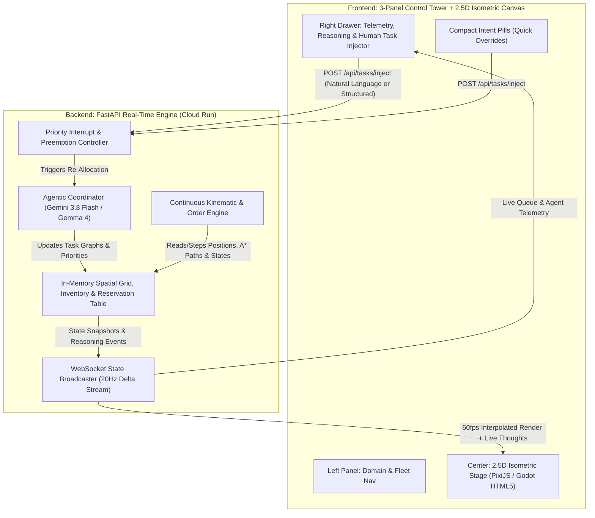
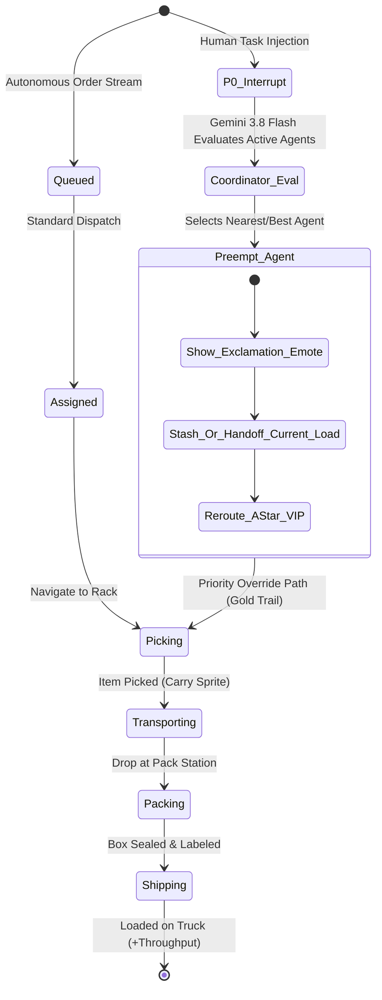

# Architecture & UI Design: Autonomous 2.5D Warehouse Simulation

> [!IMPORTANT]
> **Design Philosophy**: An "always-on" living simulation where deterministic physics/pathfinding meets real-time LLM/agentic cognition (`gemini-3.8-flash` / `gemma-4`), rendered in a crisp 2.5D isometric Godot-style canvas framed by an academic sepia **Control Tower** UI.

---

## 1. High-Level System Architecture

To ensure smooth 60 FPS animations while powered by real, un-mocked AI reasoning, the system splits agent intelligence into a **Two-Tier Hybrid Loop**:
1. **Tier 1: Strategic Cognitive Planner (LLM Dispatcher & Re-Planner)** — Triggered on state transitions, order arrivals, bottlenecks, and **human task injections**. Uses `gemini-3.8-flash` (via Vertex AI ADC on `davenport-boutique`) with structured tool calls to reprioritize queues, negotiate handoffs, and dynamically route around hazards.
2. **Tier 2: Tactical Kinematic Executor (20 Hz Tick Engine)** — Runs a deterministic spatial state machine (Hierarchical A* pathfinding, reservation tables to prevent deadlocks, velocity/acceleration vectors, and sprite animation frame states).



---

## 2. The Warehouse World & Agent Roles

### 2.1 Spatial Zones (Isometric Grid)
The warehouse is a $40 \times 28$ isometric tile map divided into functional zones:
* **Inbound Receiving Dock (North-West)**: Pallets arrive continuously; forklifts/bots unbox and restock shelves.
* **High-Density Storage Racks (Center)**: Multi-aisle shelving (`A1`–`F12`) holding categorized SKUs with visual crate stack levels.
* **Packing & Consolidation Stations (South-Center)**: Raw picked items are boxed, labeled, and taped.
* **Outbound Shipping Bays (South-East)**: Completed parcels are loaded onto waiting delivery trucks that depart and cycle on a schedule.
* **Charging & Maintenance Alcove (North-East)**: Idle or low-battery agents dock here.

### 2.2 Specialized Autonomous Agents
Each agent has a distinct 8-directional sprite sheet (`Idle`, `Walk/Drive`, `Carry_Walk`, `Pick_Reach`, `Pack_Work`, `Yield_Wait`, `Alert_Interrupted`):

| Agent Role | Visual Archetype | Core Responsibilities | Preemption Behavior |
| :--- | :--- | :--- | :--- |
| **Order Coordinator (` Foreman-01 `)** | Supervisor sprite at central podium with clipboard/holo-tablet | Decomposes incoming orders into pick/pack/ship sub-tasks; balances load across floor agents. | Immediately evaluates human-injected tasks and issues preemption interrupts to floor agents. |
| **Runner / Picker Bots (` Picker-01..04 `)** | Agile bipedal/wheeled humanoid sprites with carry-trays | Navigate narrow rack aisles, retrieve SKUs from shelves, deliver to Packing Stations. | Can **park current tote** at an aisle end-cap or transfer it to another picker to take an urgent VIP pick. |
| **Heavy Forklift / AGV (` Hauler-01..02 `)** | Heavy yellow/bronze industrial turret-loader sprites | Move bulk pallets from Receiving to Racks, and heavy consolidated crates from Packing to Shipping Bays. | Clears right-of-way immediately when a `P0_HUMAN_OVERRIDE` agent approaches on a shared artery. |
| **Packer Specialist (` Packer-01..02 `)** | Station-bound articulated sprite at conveyor tables | Scans items, folds boxes, applies priority shipping labels. | Pauses standard batch boxes on the side roller to immediately process human-flagged expedited orders. |

---

## 3. Continuous Order Lifecycle & Human Task Preemption

Because the simulation is **"always running"**, background orders flow continuously from a realistic Poisson arrival generator, while human injections act as **high-priority interrupts**.



### How Human Task Injection Works
When a human injects a task (e.g., *"Drop current picks—expedite 3x Cryo-Cooling Units from Rack C4 to Shipping Bay 1 immediately"* or *"Spill in Aisle B, reroute all haulers and send Picker-02 to inspect"*):
1. **Cognitive Parse & Assignment**: `Foreman-01` (backed by `gemini-3.8-flash`) parses the natural language command against the live warehouse state (`WorldState`), identifies the optimal agent(s) based on proximity, current load, and battery, and emits a structured `PreemptionPlan`.
2. **Visual Preemption Cue**:
   * The selected agent displays a crisp **overhead alert badge (`!`)** and a floating thought pill (e.g., *"Pausing Order #402 -> Prioritizing Human VIP Task"*).
   * Its floor path line shifts from subtle slate-blue to an animated **amber-gold priority vector**.
   * Other agents within 3 tiles automatically yield (step into alcove tiles) to grant right-of-way.
3. **Graceful Task Stashing**: If the preempted agent was carrying a standard item, it either drops it at the nearest **Buffer Staging Tile** (for another agent to pick up) or finishes its drop-off if within 4 tiles, dynamically reasoned by the coordinator.

---

## 4. 2.5D Visual & Godot-Style Sprite Engine

### 4.1 Rendering Stack Options
We can build the 2.5D viewport using one of two clean approaches:
* **Option A: HTML5 2.5D Isometric Engine (PixiJS v8 + Custom Godot-Style Sprite Atlas & Depth-Sorted Tilemap)** *(Recommended for instant web deployment, zero WASM cold-start, and seamless DOM/React/Vanilla UI overlay integration)*.
* **Option B: Native Godot 4 Engine exported to WebAssembly (HTML5 Canvas)** communicating with the UI and FastAPI backend over a JavaScript Bridge / WebSocket.

### 4.2 2.5D Visual Language & Polish
* **Isometric Projection (2:1 Pixel Ratio)**: Classic $64 \times 32$ base floor tiles with vertical rack extrusions ($64 \times 96$ sprites) and dynamic **Y-Sorting (`z = y + x`)** so agents walk naturally *behind* and *in front of* shelving racks.
* **Procedural & Keyframe Sprite Animations**:
  * Smooth 8-directional locomotion cycles with subtle bobbing, wheel dust particles on fast turns, and shadow blobs anchored below each sprite.
  * Tangible cargo rendering: when an agent picks an item, the actual crate/parcel sprite is layered onto the agent's carry-anchor point.
* **Tactical Overlays (Toggleable via Intent Pills)**:
  * **A* Path Vectors**: Dotted spline lines showing each agent's planned trajectory.
  * **Reservation Heatmap**: Subtle tile highlights showing claimed intersections.
  * **overhead Speech / Status Bubbles**: Compact pixel-crisp tags above agents showing current SKU and priority tier (`[P0 VIP]`, `[P2 STD]`).

---

## 5. UI/UX Design: Academic Sepia "Control Tower"

Following a distraction-free **Academic Light / Warm Sepia** aesthetic (`#F7F3E8` parchment canvas frame, `#EFE9D9` elevated panels, `#1E1B18` deep espresso typography, `#B85D19` burnt sienna accents, and `#2E6F40` forest telemetry indicators), the interface uses a strict **3-Panel Layout**:

```
+--------------------------------------------------------------------------------------------------+
| [● LIVE 60FPS]  AUTONOMOUS FULFILLMENT STUDIO         Pills: [⚡ Inject VIP Order] [🚧 Block Aisle] |
+--------------------+--------------------------------------------------------+--------------------+
| LEFT NAV (240px)   | CENTER WORKSPACE: 2.5D ISOMETRIC VIEWPORT              | RIGHT DRAWER(340px)|
|                    |                                                        |                    |
| ■ FLOOR ZONES      |         [Inbound Dock]          [Charging Bay]         | 🎯 HUMAN TASK      |
|  > Overview (All)  |               \                       /                |    INJECTOR        |
|  > Receiving Dock  |         +-----+-----+   +-----+-----+                  | +----------------+ |
|  > Rack Aisles A-F |        / Rack A1   /   / Rack B1   /                   | | "Prioritize    | |
|  > Packing Tables  |       +-----------+   +-----------+                    | |  SKU-99 to     | |
|  > Shipping Bays   |            🤖! <--[Picker-02: P0 Override!]            | |  Bay 1 now..." | |
|                    |            ||  (Amber Gold Path Vector)                | | [⚡ Dispatch P0]| |
| ■ AGENT FLEET (7)  |            \/                                          | +----------------+ |
|  ● Foreman-01 [AI] |      [Packing Station 1] ===> [Packing Station 2]      |                    |
|  ● Picker-01  [P2] |                                      ||                | 📋 PRIORITY QUEUE  |
|  ★ Picker-02  [P0] |                                      \/                | ★ [P0] VIP #901    |
|  ● Picker-03  [P2] |                              [Shipping Bay 1 🚚]       |   Picker-02 (Pick) |
|  ● Hauler-01  [P1] |                                                        | ● [P2] Ord #404    |
|                    |  [🔍 Zoom +/-] [🗺️ Toggle A* Paths] [📦 Toggle Labels] |   Hauler-01 (Move) |
| ■ LIVE METRICS     | +----------------------------------------------------+ |                    |
|  Orders/min: 14.2  | | 🎙️ FOREMAN-01 REASONING TICKER                     | | 🧠 AGENT THOUGHTS  |
|  P0 Preempts: 3    | | "Preempted Picker-02 from #404 (stashed at B2)     | | 11:04:12 Foreman:  |
|  Fleet Util: 86%   | |  to fulfill Human P0 injection #901 (ETA 8.4s)."   | | Re-routing...      |
+--------------------+--------------------------------------------------------+--------------------+
```

### 5.1 Left Panel: Domain & Fleet Navigation (`240px`)
* **Camera Bookmarks**: Clicking any Warehouse Zone smoothly pans and zooms the 2.5D camera to that sector.
* **Fleet Roster**: Live status chips for every agent (`Idle`, `Picking`, `Carrying`, `Preempted [P0]`). Clicking an agent locks the camera to follow them and opens their cognitive trace in the Right Drawer.
* **Compact Telemetry Sparklines**: Throughput (orders shipped/min), average fulfillment latency, and active P0 override count.

### 5.2 Center Panel: 2.5D Isometric Stage (`Flexible`)
* **Interactive Picking & Inspection**:
  * Hovering over any rack slot shows its current SKU inventory count.
  * Clicking any floor tile allows direct spatial commands (e.g., *"Send nearest agent here"* or *"Toggle Hazard Cone"*).
* **Compact Intent Pills (Top Bar)**:
  * One-click real-time scenario triggers wired directly to backend endpoints:
    * `⚡ Rush VIP Order`
    * `🚧 Drop Spill in Aisle C`
    * `📦 Restock Surge`
    * `🔋 Force Low-Battery Test`
* **Floating Bottom Ticker**: Single-line translucent sepia bar displaying the latest strategic decision from `Foreman-01`.

### 5.3 Right Expandable Drawer: Human Task Injector & Live Brain (`340px`)
* **Natural Language & Structured Task Injector**:
  * **Freeform Prompt Input**: Type any directive for the warehouse (e.g., *"Have two pickers team up to clear all Electronics from Rack D immediately"*).
  * **Priority Selector**: `P0 - Immediate Preempt (Drop Current Task)`, `P1 - Next in Queue (Finish Current Carry)`, or `P2 - Standard`.
* **Live Priority Order Queue**: Visual cards showing active orders transitioning through `Queued -> Picking -> Packing -> Shipped`, with P0 human tasks pinned to the top in burnt-sienna highlight.
* **Agent Cognitive Stream**: Real-time log of Gemini 3.8 Flash tool calls, preemption justifications, and inter-agent handoffs.

---

## 6. Key Design Decisions to Align On

Before we move to implementation, please let me know your preferences on a few architectural choices:
1. **2.5D Rendering Runtime**: Do you prefer **PixiJS / HTML5 2.5D Isometric Canvas** with custom-generated Godot-style pixel/vector sprite sheets (fastest iteration, zero WASM bundle overhead, crisp native UI integration), or a **native Godot 4 `.tscn` project** compiled to WebAssembly?
2. **Human Interaction Modes**: Beyond typing/clicking high-priority order injections, should humans also be able to **click directly on the 2.5D map** to place obstacles, drag-select agents, or manually designate drop zones?
