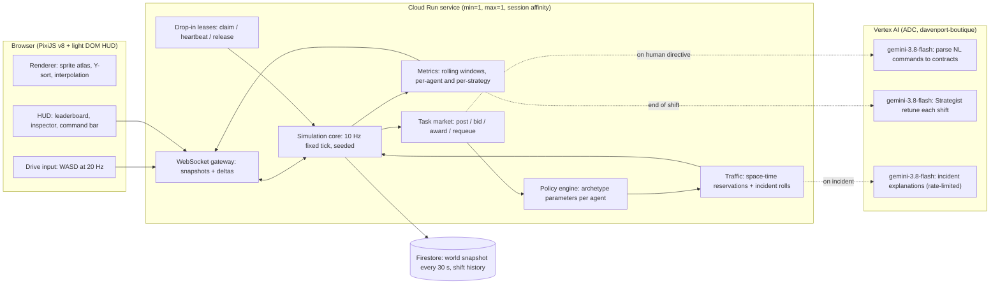

# Design Review & Revised Game Premise

> [!IMPORTANT]
> **Short version:** The mocks look like a warehouse but don't yet *behave* like a game. Every vehicle follows a fixed loop of waypoints, so there's nothing to watch for, nothing to compare, and nothing at stake when you drop in. The fix is to make **strategy the core mechanic**: agents with different temperaments **compete for the same work** in the same congested space, and the outcomes (good and bad) show up on the map and on a scoreboard.

---

## 1. Honest Review of What We Have

### 1.1 Engine premise (from the first architecture doc)
| Original decision | Problem | Recommendation |
| :--- | :--- | :--- |
| A central **Foreman** LLM assigns every task | If one brain assigns all the work, agent "personalities" don't matter. It's also the slowest part of the system (1–3 s per LLM call). | Replace it with a **task market**: orders are posted, and agents **bid** on them based on their own strategy. The coordinator only posts work and settles disputes. |
| LLM involved in many per-event decisions | Too much latency and cost for something that runs 24/7. | Real-time movement and bidding are **deterministic code**. Gemini 3.8 Flash is used only at **slow, high-value moments**: parsing human commands, adjusting an LLM agent's strategy between shifts, and writing short incident explanations. |
| Simulation state partly lived in the browser | Every viewer would see a different warehouse, and "drop in" can't work properly. | **The server owns the simulation**: one world, a fixed 10 Hz tick, a seeded random generator. Browsers only render, smoothing positions between ticks. |
| P0 human task = "swap a vehicle's path" | That's a teleport, not a decision. | P0 becomes a **high-value contract** in the market. Aggressive agents drop their current work to grab it; cautious ones finish what they're doing first. The difference is visible and measurable. |

### 1.2 Mock-specific bugs and gaps (current [warehouse_25d_ui_mockup.html](mock-v1-25d.html))
* **No real work flow:** `hasPallet` flips when a route *starts*, not at an actual pick or drop. The forks never move, and orders don't exist as objects.
* **Metrics are counters dressed up as rates:** "118 pallets/hr" just goes up by one on every visit to the east side. Under the never-mock rule, every number has to come from simulation events over a real time window.
* **Vehicles drive through each other:** only the player and P0 vehicles get right-of-way, so two ordinary forklifts overlap freely.
* **Yielding is checked in every direction:** a vehicle stops even when the other one is *behind* it. Parking the player beside a lane freezes traffic indefinitely.
* **Clicks land half a tile off:** `fromIso` rounds when it should floor, because tiles are drawn from `(gx, gy)` to `(gx+1, gy+1)`.
* **Driving feels like a board game:** WASD moves one tile per keypress. Drop-in play needs continuous throttle, steering and braking with momentum.
* **Sprite rendering:** the per-face visibility trick in `drawOrientedBox` mis-sorts faces at some angles. Redrawing ~2,000 polygons every frame is fine for a mock but not for production. Production should use **pre-rendered sprite sheets** (16 directions × a few states) loaded as PixiJS v8 textures.
* **What worked and should stay:** the full-screen map, the daylight slate/steel palette, the minimal frosted-glass HUD, the data-layer toggles (routes and traffic density), highways preferred by the pathfinder, and the docks on the west and east edges.

---

## 2. Revised Premise: "The Floor Is Always Running"

A persistent distribution center runs around the clock. Orders arrive in waves (morning rush, a lull, an end-of-day truck cutoff). A mixed fleet of agents, each with a **strategy profile**, competes and cooperates to ship them. Spectators watch the traffic and the scoreboard. At any time, a human can **take the wheel** of a vehicle or **step into the manager's chair**.

### 2.1 The three ways to engage
| Mode | What the user does | Why it's fun |
| :--- | :--- | :--- |
| **Watch** (default) | Pan and zoom, follow an agent, toggle data layers, read the leaderboard | It's like an ant farm: congestion builds, aggressive agents cut corners, incidents happen |
| **Drive** (drop in) | Pick any vehicle → **Take the Wheel**. You inherit its current contract and drive with WASD (throttle, steering, forks). **Esc** hands it back to its AI. | You show up on the leaderboard as a strategy ("Human: Jason") and compete against the agents directly |
| **Manage** | Inject rush orders and natural-language directives, place cones, close aisles, change a team's strategy settings | It's SimCity: change the system and watch what happens |

### 2.2 Strategy archetypes (each a set of policy parameters, not a script)
| Archetype | Color tag | Behavior | Upside | Risk |
| :--- | :--- | :--- | :--- | :--- |
| **Sprinter** (aggressive) | Signal orange | 1.3× top speed, short safety buffer, ignores soft reservations, cuts through picking aisles | Highest pallets per hour when the floor is quiet | Near-misses → collisions (stuck 20 s, damaged pallet, order goes back in the queue); burns battery much faster |
| **Steady** (cautious) | Steel blue | Respects every reservation, wide buffer, yields early | Almost no incidents, predictable | Slow during rushes, misses truck cutoffs |
| **Batcher** | Slate violet | Holds off until it can carry 2–3 orders headed the same way | Best energy use per order | High delay on each order, poor at P0 work |
| **Opportunist** | Amber | Grabs the most valuable nearby contract, even one another agent is already heading for | Wins P0 and rush bonuses | Starts bidding wars, wastes trips, annoys the other agents (fewer cooperative yields to it) |
| **Strategist** (LLM-tuned) | Teal outline | Starts as Steady; every in-game shift, Gemini 3.8 Flash reads its metrics and adjusts its parameters, with a one-line explanation | It adapts as conditions change, and you can read its reasoning | Can over-correct, and that's interesting to watch |
| **Human** | Bright teal | Whatever you do | Bragging rights | Agents treat you as unpredictable and give you a wider berth |

> [!TIP]
> **Balance rule:** no strategy should win under every condition. Sprinters should win quiet shifts and lose rush hours. Batchers should win energy and lose the P0 board. We tune this with seeded A/B shifts on Cloud Run Jobs, never on the laptop.

### 2.3 Risk mechanics that make "may or may not work" real
* **Space reservations:** each vehicle claims the tiles it's about to enter, a few seconds ahead. Respectful agents wait for a claimed tile to clear. Aggressive ones may enter it anyway, and that is what produces a **near-miss**.
* **Near-miss → incident roll:** the chance of an incident grows with both vehicles' speed and how much their paths overlap. An incident means both stop, a red cone marker appears, the pallet may be damaged, and the order is requeued.
* **Battery:** energy use grows with the square of speed. Running low forces a trip to a charger, which takes time.
* **Congestion:** the traffic density layer is computed from actual tile occupancy. Gridlock emerges on its own; nothing is scripted.

---

## 3. Revised Architecture



**Key choices**
* **One process, one world:** `max-instances=1` keeps a single owner of the simulation. WebSockets reconnect automatically when Cloud Run's 60-minute connection limit is hit, and the server resends a full snapshot on reconnect.
* **10 Hz simulation, 60 fps rendering:** the browser smooths motion between the two most recent ticks. Player input travels to the server and comes back authoritative, with client-side prediction for your own vehicle only.
* **Game time vs. real time:** 1 real minute = 1 in-game hour, so a full "day" with all its rush waves and truck cutoffs plays out in about 24 minutes.
* **LLM budget:** at most roughly 1 call per 10 s overall, plus calls triggered by human commands. If Vertex fails, the UI shows the error plainly, with no canned fallback text.

---

## 4. UI Updates

Keep the full-screen map and frosted HUD, and add only what supports the new premise:

```
+------------------------------------------------------------------------------------------+
| [● 07:42 Day 3  Rush wave 2/4]  Shipped 412 · On-time 91% · Incidents 3     [Layers] [+-] |
|  +---------------------------+                                                           |
|  | STRATEGY BOARD   (fold) ▾ |                 ( full-bleed 2.5D map )                   |
|  | Sprinter  ██████ 58/hr ⚠2 |                                                           |
|  | Opportun. █████  51/hr ⚠1 |                                                           |
|  | Strategist████   47/hr ⚠0 |                                                           |
|  | Steady    ███    41/hr ⚠0 |                                                           |
|  | Batcher   ███    39/hr ⚠0 |                                                           |
|  | Human:You ██     12/hr ⚠0 |                                                           |
|  +---------------------------+                                                           |
|                                                                                          |
|  +-- INSPECTOR: FL-04 · Sprinter ------+   +-- COMMAND BAR --------------------------+    |
|  | Contract #A-221 → Bay E2 (ETA 0:41) |   | [⚡ Rush wave] [🚧 Cone] [ type order… ] |    |
|  | Speed 1.3× · Battery 34% · ⚠ 2      |   +-----------------------------------------+    |
|  | [ 🎮 TAKE THE WHEEL ]  [ Follow ]   |                                                  |
|  +-------------------------------------+         toast: "FL-04 near-miss with AGV-02"     |
+------------------------------------------------------------------------------------------+
```

* **Strategy Board** (top left, foldable): one row per archetype showing throughput, incidents, and a sparkline. Click a row to highlight that team's vehicles on the map.
* **Agent markers on the map:** a small colored chevron under each vehicle shows its archetype. Text labels appear **only** for incidents, P0 work, or the vehicle you're driving.
* **Event toasts** (bottom right, short-lived): incidents, bidding wars, and Strategist retunes with Gemini's one-line reason. No permanent log on screen; full history lives in a drawer.
* **Drive mode HUD:** a speed gauge, battery, fork height and the contract timer replace the inspector. **Esc** returns control to the AI.

---

## 5. Recommended Next Steps
1. **Update the mock** so it demonstrates the new loop: five archetypes bidding for real order objects, reservations with near-misses and incidents, a live Strategy Board computed from events, and **Take the Wheel** with continuous driving. All in the browser, for review only.
2. If the loop feels right, **write the engine spec** (tick order, market protocol, policy parameter table, WebSocket message schema), then build the backend with unit tests (`uv run pytest`).
3. **Sprite pipeline:** commission or render 16-direction sprite sheets for each vehicle type, replacing the hand-drawn canvas shapes.

### Open questions for you
* **Persistence:** should the warehouse be truly persistent (Day 1, 2, 3… with history saved), or reset every in-game day?
* **Multiplayer:** can several people drive at once in the same world (shared leaderboard), or is it one driver at a time?
