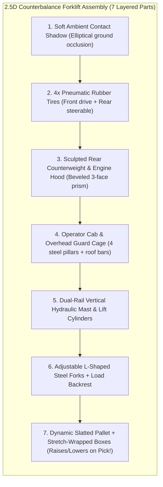

# Visual Style Guide & 2.5D Sprite Specification

> [!NOTE]
> **Aesthetic Direction**: **Architectural Daylight SimCity / Industrial Digital Twin**. Clean, sunlit concrete facility in cool architectural grays and slate blues (`#E2E8F0` – `#334155`), steel-blue racking (`#1D4ED8` / `#2563EB`), crisp directional drop shadows, and high-detail multi-part industrial vehicles that orient smoothly in 8/360° isometric space.

---

## 1. Color System & Surface Palette

### 1.1 Facility Architecture (Daylight Cool Gray & Slate)
| Token / Role | Hex | Preview / Usage |
| :--- | :--- | :--- |
| **Canvas Sky / Void** | `#CBD5E1` | Exterior asphalt / surrounding lot outside the warehouse walls |
| **Polished Concrete Floor (Aisles)** | `#EAECEF` | Sunlit smooth troweled concrete floor tiles |
| **Concrete Joint Grid Line** | `#D5DBE3` | Subtle `1px` expansion joints between concrete slabs |
| **Storage Zone Pad** | `#DFE4EA` | Slightly cooler recessed concrete under pallet rack footprints |
| **Arterial Highway Lane** | `#D4DFED` | Painted steel-blue/slate main traffic corridors for two-way forklift flow |
| **Lane Striping & Chevrons** | `#3B82F6` / `#94A3B8` | Crisp dashed centerlines, crosswalk ticks, and directional floor arrows |
| **Perimeter Dock Apron** | `#C6D0DC` | Heavy-duty reinforced concrete at Receiving (West) and Shipping (East) bays |

### 1.2 Industrial Structures & Racking
| Element | Top Face (Sunlit) | Left Face (Midtone) | Right Face (Shadow) | Accent / Detail |
| :--- | :--- | :--- | :--- | :--- |
| **Heavy Steel Upright Frames** | `#2563EB` | `#1D4ED8` | `#1E3A8A` | Bolted diagonal X-bracing |
| **Load Crossbeams** | `#64748B` | `#475569` | `#334155` | Safety load-capacity stencil tags |
| **Wooden Euro-Pallet Base** | `#D6B386` | `#B89263` | `#967247` | Fork-entry slot cutouts |
| **Stretch-Wrapped Cargo** | `#F8FAFC` / `#93C5FD` | `#CBD5E1` / `#60A5FA` | `#94A3B8` / `#3B82F6` | Barcode label & corner guards |
| **Automated Roller Conveyor** | `#94A3B8` | `#64748B` | `#475569` | Metallic silver rollers (`#E2E8F0`) |

### 1.3 Fleet & Traffic Semantic Accents
| Vehicle / State | Primary Body | Trim / Cab | Floor Halo / Path Line | Meaning |
| :--- | :--- | :--- | :--- | :--- |
| **Autonomous Counterbalance Forklift** | `#3B82F6` (Steel Blue) | `#1E293B` (Charcoal Cage) | `#60A5FA` (Soft Blue) | Standard autonomous pallet transport |
| **Autonomous Narrow-Aisle Reach Truck** | `#475569` (Slate Titanium) | `#0F172A` (Dark Mast) | `#94A3B8` (Slate) | High-bay picking & rack replenishment |
| **Autonomous Underride Deck AGV** | `#0284C7` (Cerulean) | `#E0F2FE` (LED Bumper) | `#38BDF8` (Cyan-Blue) | Fast conveyor-to-pack tote runner |
| **Human Operator (`FL-00 YOU`)** | `#0D9488` (Industrial Teal) | `#F0FDFA` (White Roof) | `#14B8A6` (Crisp Teal Ring) | Player-driven rig (WASD / Click-to-Drive) |
| **P0 Priority Override State** | `#EA580C` (Signal Amber) | `#FEF3C7` (Beacon Glow) | `#F59E0B` (Gold Express Line) | Human-injected urgent task preempting queue |
| **Traffic Yield / Braking State** | — | `#EF4444` (Brake Tail-LED) | `#FCA5A5` (Yield Arc) | Pausing at intersection for right-of-way |

---

## 2. High-Detail 2.5D Sprite Anatomy

Instead of generic flat boxes, every vehicle is rendered as an **articulated multi-part 2.5D isometric assembly** oriented along its true directional heading vector $(\cos\theta, \sin\theta)$:

### Vehicle Archetypes in the Fleet
1. **Counterbalance Sit-Down Forklift (`FL-00`..`FL-05`)**:
   * **Visual Details**: Wide front drive wheels, tapered rear counterweight with vent grilles, dark charcoal 4-post roll cage with seated operator silhouette, twin vertical chrome/steel mast rails, extending steel forks, and roof-mounted LED strobe.
   * **Animation**: Forks physically elevate (`z = 2px -> 36px`) when picking/placing a pallet from a high rack tier; brake lights glow red when yielding at an intersection.
2. **Low-Profile Underride AGV (`AGV-01`..`AGV-04`)**:
   * **Visual Details**: Sleek beveled octagonal chassis in steel-blue/slate, front laser LiDAR scanner crescent, cyan/blue perimeter safety LED strip, and top scissor-lift platform carrying dual totes.
3. **Docked 53-Foot Semi-Trailers (West Receiving & East Shipping)**:
   * **Visual Details**: Ribbed aluminum trailer roof, rear roll-up dock doors, rubber dock bumpers, yellow wheel chocks, and visible pallet stacks inside the trailer bed as it fills up.

---

## 3. Large-Scale Pan-able Facility Map ($36 \times 24$ Grid)

The facility is a **large pan-able & zoomable industrial floor ($36 \times 24$ tiles)** organized like a real distribution center with SimCity-style road hierarchy:
* **West Apron (`x = 1..3`)**: 4 Inbound Receiving Docks (`DOCK W1–W4`) with docked freight trailers and pallet staging lanes.
* **North & South Arterial Boulevards (`y = 3` and `y = 20`)**: 2-lane painted collector highways with directional arrows for high-speed cross-warehouse transit.
* **Central Cross-Town Avenue (`y = 11..12`)**: Wide central boulevard separating the North Reserve Racks from the South Fulfillment Racks.
* **12 Multi-Tier High-Bay Rack Isles (`A` through `L`, `x = 6..25`)**: Double-deep 3-tier steel pallet racks with clear aisle markers stenciled on the concrete floor (`AISLE 1`–`AISLE 6`).
* **Consolidation & Conveyor Hub (`x = 27..30, y = 6..17`)**: Automated powered roller conveyors sorting parcels to outbound lanes.
* **East Shipping Apron (`x = 32..35`)**: 4 Outbound Shipping Bays (`BAY E1–E4`) where forklifts load completed orders directly into waiting trailers.

---

## 4. Minimal Frosted-White HUD System

To keep **95% of the screen dedicated to the living warehouse map**:
* **Top-Left Mini Pill**: Facility title, live pallet throughput counter, and fleet utilization bar.
* **Top-Right SimCity Layer Switcher**: Clean light-mode segmented buttons (`Routes`, `Traffic Flow`, `Lane Markings`, `Rack Labels`, `Zoom +/-`, `Recenter`).
* **Bottom-Center Command & Priority Bar**: Compact frosted-glass bar (`rgba(255, 255, 255, 0.88)`) to inject a natural-language task, trigger an instant **P0 Priority Forklift Preemption**, or toggle the **Aisle Barrier** tool.
* **Bottom-Left Inspector Mini-Card**: Shows the currently selected forklift/AGV (or your `FL-00` rig), its current speed, load, and active route destination.
