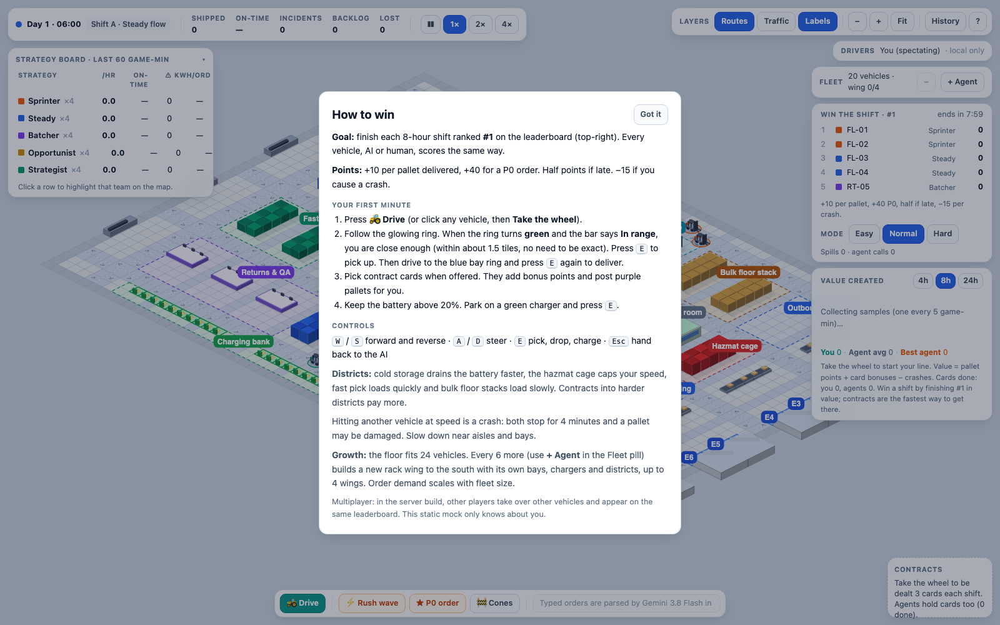
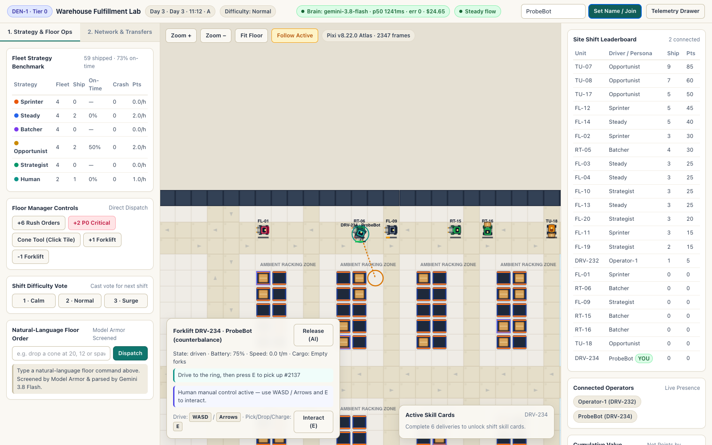
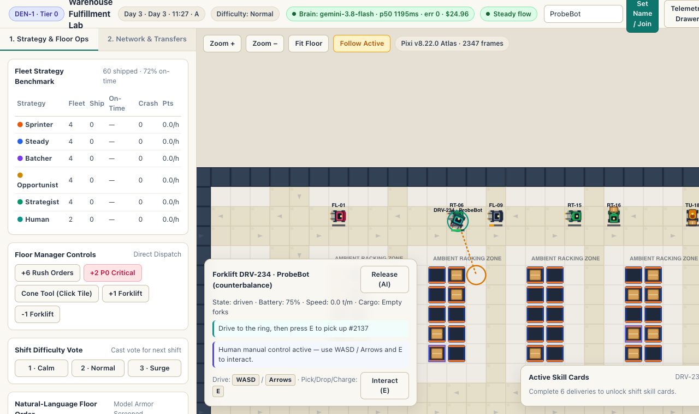
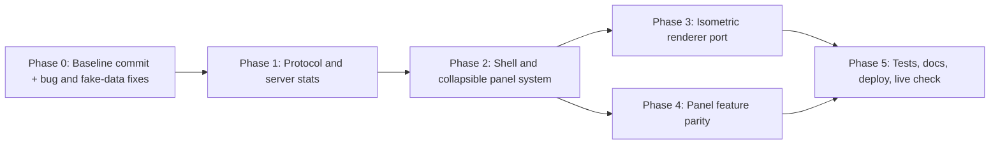

# Warehouse client: fix the live build and bring it up to mock v4

**Mock (the target):** [warehouse_sim_mock_v4.html](mock-v4.html)
**Live build:** https://warehouse-lobby-txgsracloq-uc.a.run.app

## Goal

The backend works. I played DEN-1 in headless Chrome and saw:
- Day 3 with 925 pallets shipped,
- real Gemini 3.8 Flash calls at a median of about 1.2 s,
- typed orders going through Model Armor and running,
- server-side driving that moves the forklift (x went from 10.5 to 20.85 in 3 s).

The **client** is the problem. It is a fixed 3-column dashboard with a flat top-down map. The mock is a full-screen isometric floor with floating panels you can fold away. Many panels show frozen or made-up data, and nothing collapses except one drawer.

This plan:
1. fixes the bugs and the no-fake-data violations,
2. sends the missing data from the server,
3. rebuilds the client shell around collapsible floating panels,
4. ports the mock's isometric renderer,
5. ships and verifies it live.

````carousel

<!-- slide -->

<!-- slide -->

````

---

## What I found playing the live build

| # | Finding | Severity |
|---|---|---|
| 1 | The inspector shows **Speed 0.0** while you drive. The server reports speed 3, but the panel never refreshes. | High |
| 2 | **Your own contract cards never appear.** The client looks up your hand by vehicle id, but the server stores it by player id (`main.ts:994`, `engine.ts:912`). | High |
| 3 | The **Strategy Board, value chart, day history and hall of fame freeze** after you join. Their data is only sent once, when you connect. The client also reads `stats.series`, which the server never sends. | High |
| 4 | **Made-up data:** if the network call fails, the client invents site cards (`main.ts:1200`). It also shows a placeholder brain budget of \$10, invents a "gemini-3.8-flash, 0ms" decision record, hardcodes the driver cap as "/8" (the real cap is 32), and shows 100% on-time when nothing has shipped. | High (breaks the no-fake-data rule) |
| 5 | The clock reads **"Day 3 · Day 3 · 11:12"**. | Med |
| 6 | Driving input is only sent when a key changes. Key-repeat floods messages, a held key sticks if you switch windows, and WASD/E are captured even when you are not driving. The prediction rubber-bands. | Med |
| 7 | The camera follows any vehicle you click, and the guide ring is drawn for AI vehicles too. | Med |
| 8 | The event log is in mixed order. On first load it shows the 35 **oldest** events. | Med |
| 9 | Labels are wrong. "+6 Rush" actually posts 12 orders and "+2 P0" posts 1. The "Pts" column is really "/hr". The card copy "Complete 6 deliveries…" is untrue. | Low |
| 10 | The renderer advertises "Pixi v8 Atlas" but draws everything with Canvas2D. Pixi is loaded and never used. Hazmat racks and bay pads use the wrong sprites. | Low |
| 11 | At 1280 px wide, the top bar wraps and cuts off. Name labels overlap ("RT-1DRV-235"). | Low |

The full line-by-line inventory (30+ missing visual elements, 12 missing collapse behaviours, data-wiring table) is in [the gap analysis](gap-analysis.md).

---

## User Review Required

> [!IMPORTANT]
> **The mock's layout and visual style conflict with your saved UI rule.** Your rule asks for a sepia/academic look and a strict 2–3 panel layout. The mock uses a cool slate palette and frosted floating panels over a full-screen canvas.
>
> **My recommendation:** keep the mock's structure, mapped onto your 3-zone rule:
> - **Left zone:** the KPI bar, the Strategy Board and the Network panel.
> - **Centre:** the full-screen floor, with the command bar and inspector floating over it.
> - **Right zone:** a slide-out drawer with Leaderboard, Value, Days, Events and Brain log.
>
> Every panel can be folded down to a small pill. For colour, I'd use the mock's frosted panel style with your sepia palette. See Q1 and Q2.

> [!WARNING]
> **This is a large rewrite of `apps/client`.** It replaces most of `index.html`, `styles.css` and `renderer.ts`, and splits the 1,300-line `main.ts` into modules. The repo has **no commits yet** (`git log`: "main does not have any commits yet"). I'll make a baseline commit of the current tree before touching anything, so every change can be reviewed and reverted. The commit stays local; I won't push.

> [!NOTE]
> **Two mock controls are deliberately dropped**, because they can't be honest on a shared, server-run floor:
> - The **speed buttons** (❚❚/1×/2×/4×): the site runs 24/7 at 1× for everyone.
> - **Reset world**: it would wipe the shared floor for every player.
>
> Neither will be faked. Difficulty stays a **vote**, styled like the mock's Easy/Normal/Hard buttons, with the current level highlighted and the vote count shown.

## Open Questions

> [!IMPORTANT]
> **Q1. Renderer.** Should I port the mock's **isometric 2.5D** Canvas2D renderer? That brings raised racks, districts, trucks, trailers, beams, headlights and level-of-detail. It means dropping the unused Pixi dependency and the top-down sprite atlas, or keeping the atlas only for vehicles. **Recommended: yes, port the iso renderer.** It is the biggest visual gap. The alternative is to keep the top-down view and only restyle it.

> [!IMPORTANT]
> **Q2. Palette.** Which should I use?
> - **(a) Recommended:** the mock's frosted panels and layout, with your sepia/academic colours.
> - **(b)** The mock's slate palette exactly.

**Q3. Default panel state for first-time visitors.** I suggest:
- Expanded: KPI bar, Strategy Board, Leaderboard.
- Collapsed: Value chart, Network.
- Drawer: closed.
- The help modal opens automatically on the first visit, as in the mock.
- Below 1366 px wide, everything except the KPI bar and command bar folds to pills.

Each player's panel choices are remembered in their browser. Okay?

---

## Proposed Changes



### Phase 0: Correctness and no-fake-data fixes (`apps/client`)

**[MODIFY] main.ts.** These fixes ship even if later phases change.

- **Clock.** Use `clockText(t)` once, so the day isn't doubled:
  ```diff
  - clockPill.textContent = `Day ${dayIndex(this.world.t) + 1} · ${clockText(this.world.t)} · ${shiftName(this.world.t)}`;
  + clockPill.textContent = `${clockText(this.world.t)} · Shift ${shiftName(this.world.t)}`;
  ```
- **Cards.** Look up the hand by `you.clientId`, not by vehicle id. Keeping cards becomes a multi-select with a "Keep N cards" button that sends all the chosen ids, as in the mock.
- **Input.**
  - Only capture WASD/E/arrows while you are driving.
  - Ignore key-repeat (`ev.repeat`).
  - Release all keys when the window loses focus.
  - While a key is held, send input at a steady **10 Hz** with real elapsed time, so replay after the server's ack matches what the server simulated.
  - This also keeps the server's 5 s input lease alive without depending on key-repeat.
- **Inspector.** Refresh it on every update, using a change key, as the mock does. This fixes "Speed 0.0".
- **Camera.** Follow only the vehicle you are driving. Draw the guide ring only for your own vehicle.
- **Event log.** Keep it in one order (newest first) and cap it at 120 entries.
- **Brain-thinking badge.** Keep the last known value when a light update leaves the field out, so the badge stops flickering.
- **Remove all made-up data.** No invented site cards (show the real error instead). No placeholder brain health (show "—" until the first real message). No invented decision record (the real fields arrive from Phase 1). The driver cap comes from the server. On-time shows "—" when nothing has shipped.
- **Labels.** Fix the button labels to match what the server actually posts. The board columns will be /hr, On-time, ⚠ and kWh/ord.

### Phase 1: Missing data in the protocol and server (`packages/protocol`, `apps/site`, `packages/sim`)

Today the Strategy Board, value chart, Days history, hall of fame, routes and traffic layers, and the inspector detail are only sent once, at connect. This phase sends them on an ongoing basis.

**[MODIFY] protocol `index.ts`.** Extend `DeltaStats` and the vehicle delta:

```ts
// in DeltaStats (attached to the full delta that already goes out every 10th background tick)
board?: BoardRow[];          // board(world): strategy, n, perHr, onTime, incidents, kWhPerOrder
series?: ValueSample[];      // samples appended since the last full delta (append-only)
history?: DayRecord[];       // only sent when a day closes
hall?: HallEntry[];          // only sent when it changes
heat?: { w: number; h: number; cells: [number, number][] }; // sparse, every 2 s, only to subscribed clients

// in QuantisedVehicleDelta (full deltas only)
incidents?: number; nearMisses?: number; tactics?: string;
path?: [number, number][];   // next 12 waypoints, quantised
decision?: { kind: string; model: string; latencyMs: number; reason: string }; // real brain metadata
```

**Server changes:**
- **[MODIFY] site `server.ts`:**
  - Fill in the fields above.
  - Send each player only their own card hand. Today everyone receives everyone's hands.
  - Add a `{type:'layers', traffic:boolean}` message, so heat data is only sent to clients that have the Traffic layer turned on.
- **[MODIFY] site `brain.ts`:** Record `model`, `latencyMs` and `kind` on every real decision, so the client never has to invent them.
- **[MODIFY] `docs/protocol.md`:** Document the new fields. This keeps docs, code and tests in step.

### Phase 2: Shell and collapsible panel system (`apps/client`)

**[MODIFY] index.html, styles.css.** Replace the 3-column grid with:
- a full-screen `<canvas>`,
- floating HUD zones (`#zoneLeft`, `#zoneRight`, `#zoneBottom`),
- a slide-out `<aside id="drawer">`.

The panel style follows the mock: frosted glass with `blur(12px)`, 14 px corners, two-layer shadow, uppercase `.label`s, mono keycaps. It also gets the custom scrollbars and `prefers-reduced-motion` support.

**[NEW] `src/ui/panel.ts`.** One reusable collapsible panel component, used by every HUD module:

```ts
export interface PanelOptions {
  id: string;               // localStorage key: warehouse.panel.<id>
  title: string;            // uppercase label in the header button
  zone: 'left' | 'right' | 'bottom';
  defaultState: 'open' | 'collapsed' | 'hidden';
  hotkey?: string;          // e.g. 'B' toggles the board
  summary?: () => string;   // one-line pill text when collapsed, e.g. "Board · Sprinter 6.0/hr"
}
export function createPanel(opts: PanelOptions, body: HTMLElement): PanelHandle;
```

Panel behaviour:
- The header acts as a fold button (▾/▸, with `aria-expanded`).
- A collapsed panel shrinks to a **pill** that shows a live summary.
- Open/closed state is remembered per panel.
- Below 1366 px wide, panels fold automatically. A choice the player has made always wins over the automatic fold.

**Every collapse behaviour from the mock is covered, plus new ones:**

| Behaviour | Control |
|---|---|
| Fold the Strategy Board | header / `B` |
| Open and close the drawer, with slide animation and ✕ | `History` button / `H` / ✕ |
| Drawer tabs | Leaderboard · Value · Days · Events · Brain log |
| Inspector hides when nothing is selected; ✕ or Esc deselects | ✕ / `Esc` |
| Contract offer panel shows and hides on its own | automatic |
| Help modal: `?` opens it, "Got it" closes it, opens automatically on the first visit | `?` |
| Drive guidance bar shows only while you drive | automatic |
| Toasts: at most 4 on screen, close themselves after 5.5 s | automatic |
| Value chart window | 4h / 8h / 24h tabs |
| Layer toggles | Routes / Traffic / Labels (`1` / `2` / `3`) |
| Cone mode: crosshair cursor, Esc exits | `C` / `Esc` |
| *New:* fold Fleet, Network and Leaderboard | header |
| *New:* hide all panels for a clean view of the floor | `Tab` |

**[NEW] modules split out of `main.ts`:**
- `src/net.ts`: joining, the WebSocket connection, reconnecting.
- `src/input.ts`: keyboard handling, the 10 Hz input loop, prediction.
- `src/state.ts`: one client store that the panels subscribe to.
- `src/ui/*.ts`: one file per panel (next phase).

### Phase 3: Isometric renderer port (`apps/client/src/renderer.ts`)

**[MODIFY] renderer.ts.** Rewrite it from the mock's `<script id="render">` (mock lines 1406–1785) as typed Canvas2D. It reads the client world plus a set of render options.

What it draws:
- **Projection and camera:** 2:1 isometric projection with `TW=64, TH=32` and extruded boxes. Wheel zoom centres on the cursor (0.12–3.2). Drag panning starts after 4 px, using pointer events with capture. The view re-fits when the facility expands. Screen density is capped at 2×.
- **Smooth motion:** other vehicles slide between the last two server updates instead of snapping.
- **Floor:** floor colours per district, dashed centre lines, rack shadows, district outlines, and district name pills (Fast pick, Hazmat cage, Charging bank, and so on).
- **Racks and structures:** 3D racks with stock, simplified at low zoom; offices and benches; conveyors with moving totes; dock trucks at the west wall; east trailers that slide out with a fill bar.
- **Pads:** bay pads and charger pads.
- **Orders:** pickup rings (team colour, gold for P0, purple for cards) and order pallets.
- **Floor events:** spill rings that shrink as they expire, pulsing incident markers with pills, and cones.
- **Vehicles:** 3D AGV, counterbalance and reach-truck models. Each has a team-coloured counterweight, forks that rise, cargo stacks, a beacon, brake lights, a headlight pool, a charging pulse and a "stunned" ring.
- **Map labels:** `★ id` pills, and id plus battery labels at higher zoom.
- **Your guidance:** a ring that pulses and turns green when you are in range, a light beam, a dotted line from your vehicle, and a "Press E" label pinned to the screen edge.
- **Layers and highlight:** the Routes, Traffic and Labels layers, and team highlight (other vehicles dimmed to 40%).
- **Kept from the live build:** the brain thinking/error badges and the transfer bay.

**[DELETE]** the Pixi texture code and the `pixi.js` dependency. They are unused today. The sprite atlas tool stays in the repo but is no longer used by the client.

### Phase 4: Panel feature parity (`src/ui/*.ts`, all [NEW])

| Module | What matches the mock |
|---|---|
| `kpiBar.ts` | Live dot, clock, `Shift A · <phase>`, and the Shipped / On-time / Incidents / Backlog / Lost counters. Also the site badge, brain-health pill and reconnect pill (live-only extras). |
| `strategyBoard.ts` | Sorted by /hr, colour swatches, ⚠ in red, kWh/ord. Clicking a row highlights that team on the map. Fed by the server's `stats.board`. |
| `toolbar.ts` | Layer toggles, − / + / Fit, History, `?` |
| `presence.ts` | A compact "Drivers" pill ("You (driving FL-03) · 3 drivers") that expands into the operator list. |
| `fleet.ts` | "`N vehicles · wing T/MAX`" with + Agent / −. Buttons are disabled at the server's limits, and the tooltip explains the wing threshold. |
| `leaderboard.ts` | "Win the shift · #rank · ends in H:MM", top 5 plus "⋯" plus your row, your record, spills and agent calls, Easy/Normal/Hard vote with vote count and tooltips, hall of fame. |
| `valueChart.ts` | SVG with 4h/8h/24h windows, relative to the window start. Lines for You, Agent avg and Best agent, with a legend and zero line. Fed by appended `stats.series` samples. |
| `cards.ts` + `deal.ts` | A hand of cards with points, progress bars and status colours. A floating offer panel with multi-select and "Keep N". |
| `inspector.ts` | Hidden unless something is selected. 3×2 grid (battery, speed or fork height, shift points, incidents, near-misses), contract due time, policy, and the brain decision with **real** model and latency. Take the wheel `T` / Hand back `Esc`. |
| `commandBar.ts` | 🚜 Drive (quick-picks the best idle vehicle) · ⚡ Rush · ★ P0 · 🚧 Cones · typed-order box with the echo shown in a toast. |
| `driveBar.ts` | "✓/▶ guide text · N tiles · #rank · pts" |
| `toasts.ts` | Coloured by event type, as in the mock, at most 4, closing after 5.5 s. Errors from the server appear here too. |
| `drawer.ts` | Tabs: Leaderboard (full) · Value · Days (`stats.history`) · Events (120, newest first) · Brain log |
| `network.ts` | Site cards with real data only, Switch with feedback, and the network leaderboard. Shown as a foldable left panel instead of a tab. |
| `help.ts` | The mock's "How to win" content, updated for multiplayer. |

---

## Verification Plan

### Automated tests (`npm test`, Vitest; heavy runs stay off this laptop)
- **[MODIFY] `apps/client/test/client.test.ts`**, plus new test files under `test/ui/`. These test the pure view-model functions:
  - clock formatting (no doubled day),
  - card hand lookup by player id,
  - multi-select keep,
  - event ordering and the 120 cap,
  - value-chart window and relative values,
  - board sorting,
  - panel state saving and restoring, plus automatic folding by width,
  - input: ignores key-repeat, releases keys on window blur, 10 Hz send timing, replay matches the server step.
- **Renderer:** pure tests for the isometric projection and its inverse, cursor-centred zoom, and the camera re-fit on expansion.
- **[MODIFY] `packages/protocol/test`:** the new schema fields, and per-player card hands.
- **[MODIFY] `apps/site/test`:**
  - `board`, `series`, `history`, `hall` and `decision` appear in deltas;
  - heat is only sent to clients that subscribed;
  - no client receives another player's hand.
- **Docs:** the existing docs-vs-code test extended to cover the new fields in `docs/protocol.md`.
- Also run `npm run build` across all workspaces.

### Deployment and live check
1. Deploy through Cloud Build (`cloudbuild.yaml`) to Cloud Run in `davenport-boutique`: the lobby plus the 4 site services.
2. **[NEW] `tools/smoke/ui.mjs`:** a Playwright script that drives the system Chrome. It is a formal version of the probe I ran today, and runs against the live lobby. It:
   - checks the clock format,
   - folds and unfolds every panel and checks it stays that way after a reload,
   - opens the drawer and every tab,
   - drives for 3 s and checks that both the inspector speed and the forklift's position change,
   - checks that the card hand appears once you are driving,
   - checks that the board and value chart **change** over 60 s, not frozen,
   - takes screenshots at 1600×1000 and 1280×760,
   - finds no console errors.

   The script closes its browser and WebSocket when it finishes, and its driver name starts with `smoke-` so it is kept off the human leaderboard.
3. Probe `GET /` and `/api/network` over HTTP and report the live URL.
4. Write a walkthrough with before/after screenshots and a recording of folding the panels.

### Manual checks for you
- Play one delivery: Drive → pick up → deliver.
- Fold the panels to your liking, reload, and confirm your layout is remembered.
- Try it at laptop width.

### Mobile Touch Driving Controls & Compact Mobile HUD (`@media (max-width: 900px), (max-height: 500px)`)
- **`touchControls.ts` (`#touchControls`):** Floating virtual 8-way thumbstick on the bottom-left (`[data-role="touch-stick"]`, Pointer Events with `setPointerCapture` and `touch-action: none`) plus `Boost` (`[data-role="touch-boost"]`) and contextual `Pick` / `Drop` / `Clear` / `Take #id` (`[data-role="touch-interact"]`) buttons on the bottom-right.
- **`InputController` (`input.ts`):** Tracks keyboard (`keyHeld`) and touch (`touchHeld`) directional sets independently via `setTouchDirs` and `releaseTouch`, feeding the same 20 Hz prediction and server-reconciliation loop.
- **Compact Mobile HUD (`styles.css`, `state.ts`, `contracts.ts`):**
  - Uses dynamic viewport units (`100dvw`, `100dvh`) and `min-width: 0` on flex items to guarantee zero horizontal overflow on iPhone Portrait (`390×844`) and iPhone Landscape (`844×390`).
  - Defaults `ui.contractsCollapsed = true` on mobile/coarse-pointer viewports (`defaultContractsCollapsed`) so `#contracts` renders as a compact top-right pill (`top: 8px; right: 8px`) and expands as a popover when tapped.
  - Compacts `#run`, `.top-stack` (`#objective` + `.fare-row` at `top: 48px`), and `#dash` (`bottom: 10px`) so the center-screen forklift (`(195, 422)` in portrait, `(422, 195)` in landscape) is never obstructed.

